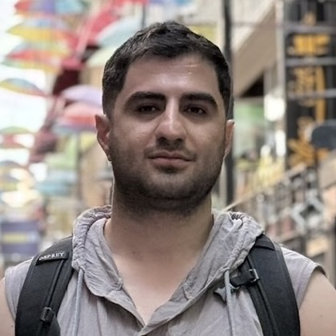

::: hero
{.portrait fig-alt="Portrait of Amir Masoud Nourollah"}

::: hero-text
# Amir Masoud Nourollah

::: role
PhD student, Department of Computer Science, [Cardiff University](https://www.cardiff.ac.uk/)
:::

::: link-row
[<i class="bi bi-envelope"></i>Email](mailto:am@nourollah.me)
[<i class="bi bi-mortarboard"></i>Google Scholar](https://scholar.google.com/citations?user=jnindL8AAAAJ)
[<i class="bi bi-github"></i>GitHub](https://github.com/Nourollah)
[<i class="bi bi-orcid"></i>ORCID](https://orcid.org/0000-0002-6083-6673)
[<i class="bi bi-linkedin"></i>LinkedIn](https://www.linkedin.com/in/amnrl)
:::
:::
:::

::: lede
I work on **scientific machine learning** for chemistry and molecular systems. My research asks when machine learning models can be trusted outside the data they were trained on: how they **generalise** under distribution shift, and how we can **interpret and explain** what they have learnt. Currently I study compositional generalisation in machine learning interatomic potentials for molecular dynamics.
:::

I am a member of the [Cardiff NLP](https://cardiffnlp.github.io/) and [Knowledge Representation and Reasoning](https://krr-cu.github.io) groups, supervised by [Prof. Steven Schockaert](https://profiles.cardiff.ac.uk/staff/schockaerts1) and [Prof. Stefano Leoni](https://profiles.cardiff.ac.uk/staff/leonis). Before my PhD I studied chemistry and then computer science, and worked for several years as a software engineer and machine learning researcher. [More about me →](about.qmd)

## News

::: news
- [2026]{.date} [*Benchmarking Compositional Generalisation for Machine Learning Interatomic Potentials*](projects/mlip-benchmark/index.qmd) published at **NeurIPS 2026**.
- [Jul 2025]{.date} [*Large Language and Reasoning Models are Shallow Disjunctive Reasoners*](https://aclanthology.org/2025.acl-long.433/) published at **ACL 2025**.
- [2025]{.date} Presented my [first-year review](presentations/annual-review-2025/index.qmd) at Cardiff University.
- [2024]{.date} Started my PhD at Cardiff University.
:::

## Selected Research

::: entry
[Benchmarking Compositional Generalisation for Machine Learning Interatomic Potentials](projects/mlip-benchmark/index.qmd){.entry-title}

::: authors
[Amir Masoud Nourollah]{.me}, Irtaza Khalid, Stefano Leoni, Steven Schockaert
:::

[NeurIPS 2026]{.venue}

::: pills
[<i class="bi bi-journal-text"></i>Project page](projects/mlip-benchmark/index.qmd){.pill}
[<i class="bi bi-file-earmark-text"></i>Paper](https://arxiv.org/abs/2605.08988){.pill}
[<i class="bi bi-easel2"></i>Talks](presentations/index.qmd){.pill}
:::
:::

::: entry
[Large Language and Reasoning Models are Shallow Disjunctive Reasoners](https://aclanthology.org/2025.acl-long.433/){.entry-title}

::: authors
Irtaza Khalid, [Amir Masoud Nourollah]{.me}, Steven Schockaert
:::

[ACL 2025]{.venue}

::: pills
[<i class="bi bi-file-earmark-text"></i>Paper](https://aclanthology.org/2025.acl-long.433/){.pill}
:::
:::

::: more
[All research →](projects/index.qmd) · [Full list on Google Scholar →](https://scholar.google.com/citations?user=jnindL8AAAAJ)
:::

## Recent Writing

::: {#recent-writing}
:::

::: more
[All posts →](blog/index.qmd)
:::
