## Overview {data-section="Overview"}

:::: {.columns .middle}

::: {.column width="64%"}
1. **Introduction**: how machine learning learns, and how chemists and computers read molecules
2. **Motivation**: where the data runs out, and what counts as new
3. **GMD: the benchmark**: familiar parts, new molecules
4. **Results**: where today's models break
5. **Takeaways**
:::

::: {.column width="36%"}
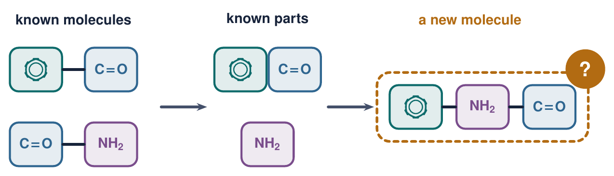
:::

::::

::: {.notes}
One sentence: chemists know a molecule from its parts; we ask whether ML models do too.
:::

::: {.bridge .fragment}
So how does a computer learn anything at all?
:::

<!-- ===================== INTRODUCTION ===================== -->

## Teaching a computer from examples {data-section="Introduction"}

:::: {.columns}

::: {.column width="48%"}
- We give the computer **examples**: inputs and the correct answers
- It tunes a flexible formula until its predictions match those answers
- "Learning" just means finding the parameters with the smallest error

::: {.key}
You already do this: fit a curve to two or three experimental points, then predict other amounts of reactant without running more experiments.
:::
:::

::: {.column width="52%"}
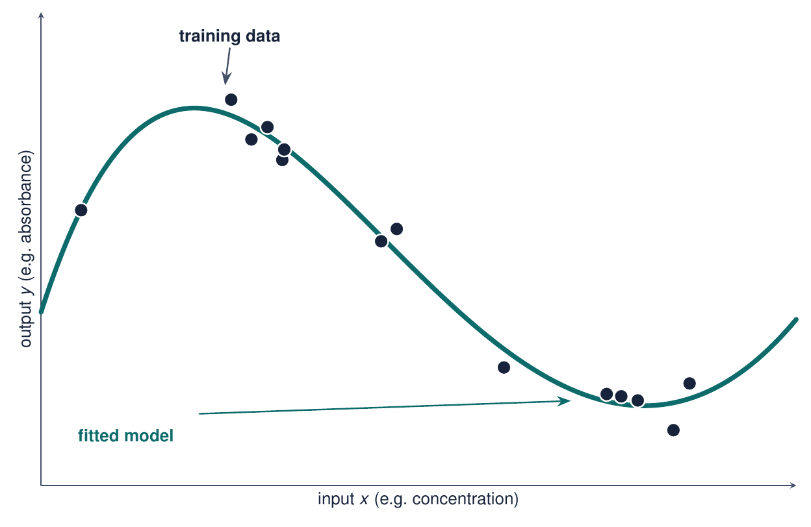
:::

::::

::: {.slide-ref}
C. M. Bishop, *Pattern Recognition and Machine Learning*, Springer (2006), ch. 1.
:::

::: {.notes}
Keep it friendly. Model = summary of the data it has seen.
:::

::: {.bridge .fragment}
Can we trust that curve everywhere, even far from the points we measured?
:::

## Inside the data versus outside it {data-section="Introduction"}

:::: {.columns}

::: {.column width="48%"}
- Between known points the model **interpolates**, and is usually reliable
- Beyond them it **extrapolates**, and nothing in the training checks it
- A very flexible model can pass every training point and still go wild just outside

::: {.key}
A small error on the training data says little about data the model has never seen.
:::
:::

::: {.column width="52%"}
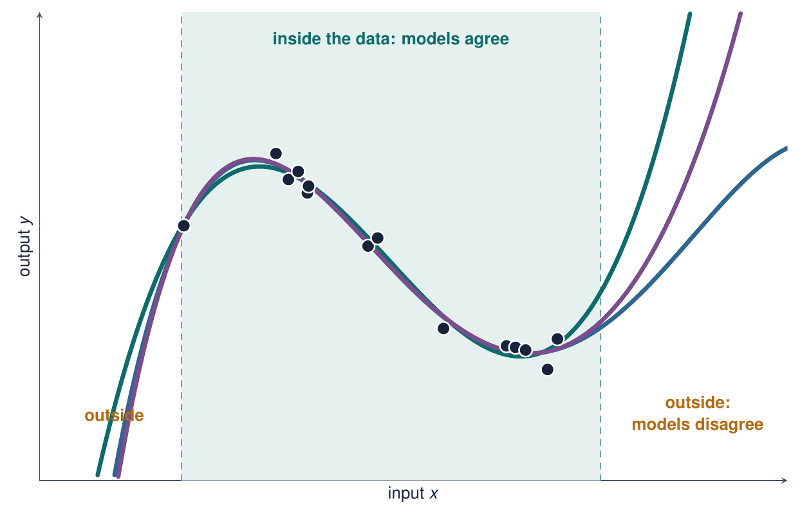
:::

::::

::: {.slide-ref}
C. M. Bishop, *Pattern Recognition and Machine Learning*, Springer (2006), §1.1, §3.2.
:::

::: {.notes}
Plant the seed: "outside the data" is the theme of the talk. Don't say "out-of-distribution" yet.
:::

::: {.bridge .fragment}
Let's see how different our interpretation of a molecule is from a computer's.
:::

## How a chemist reads a molecule {data-section="Introduction"}

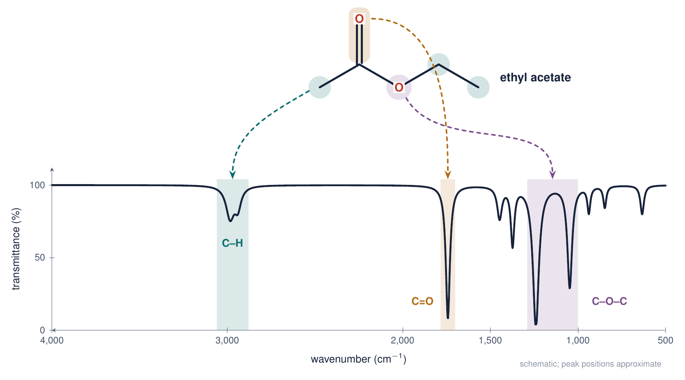{height="430px" fig-align="center"}

::: {.slide-ref}
G. Socrates, *Infrared and Raman Characteristic Group Frequencies*, 3rd ed., Wiley (2001).
:::

::: {.notes}
Each part of ethyl acetate has its own peak: C–H stretch near 2980 cm⁻¹, C=O near 1740 cm⁻¹, C–O–C near 1240 and 1050 cm⁻¹. We read the whole molecule from its parts. Schematic spectrum.
:::

::: {.bridge .fragment}
How is that different from how a computer reads a molecule?
:::

## What does a molecule look like to a computer? {data-section="Introduction"}

:::: {.columns}

::: {.column width="48%"}
- **Input**: each atom's element and 3D position, exactly what an `.xyz` file holds
- **Output**: the energy *E*, and the force on every atom
- There are many ways to give a molecule to a computer: 3D coordinates, adjacency matrices, molecular graphs, SMILES strings, fingerprints

::: {.key}
The model never sees a label like "carbonyl" or "ring": only elements and distances.
:::
:::

::: {.column width="52%"}
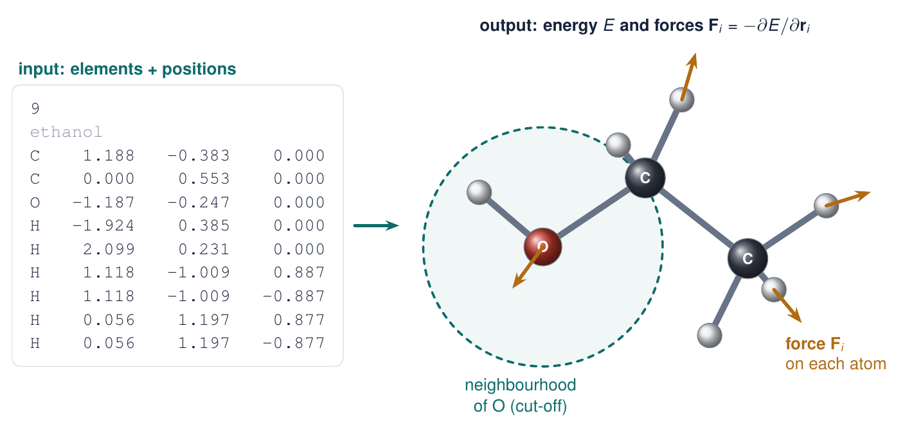
:::

::::

::: {.slide-ref}
J. Behler, M. Parrinello, *Phys. Rev. Lett.* **98**, 146401 (2007).
:::

::: {.notes}
Avoid "graph", "message passing". Neighbourhood + sum over atoms is enough.
:::

::: {.bridge .fragment}
Then does machine learning read molecules the way a chemist does?
:::

## Does machine learning read molecules this way? {data-section="Introduction"}

:::: {.columns}

::: {.column width="48%"}
- The model learns from whole molecules, one geometry at a time
- Nothing forces it to learn "parts" the way a chemist does
- It might learn rules, or it might memorise the molecules it was shown

::: {.warn}
If every part of a new molecule is familiar, does the model find the whole familiar?
:::
:::

::: {.column width="52%"}
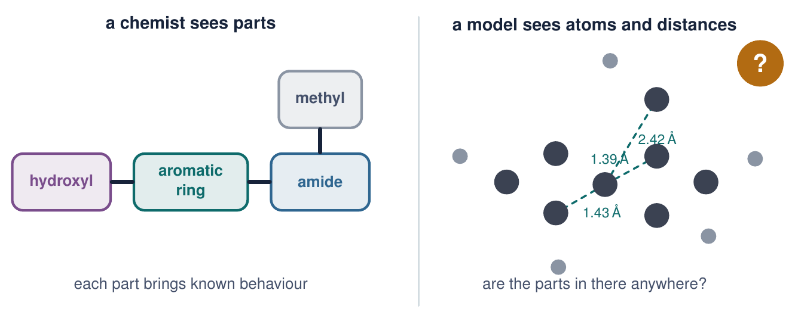
:::

::::

::: {.slide-ref}
B. Lake, M. Baroni, *Proc. ICML* (2018).
:::

::: {.notes}
Analogy: a student who memorised answers for 20 molecules vs one who learned group frequencies. Both score well on the homework; only one passes the exam.
:::

::: {.bridge .fragment}
Where to get these data, and how?
:::

## Any method can supply the data and become a teacher {data-section="Introduction"}

:::: {.columns}

::: {.column width="48%"}
- From CCSD(T) to GFN2-xTB, every method gives energies and forces for a geometry
- So **any** of them can supply training data
- Datasets range from ten small molecules (MD17) to over 100 million calculations (OMol25)

::: {.key}
A model is at best as accurate as the method that produced its data.
:::
:::

::: {.column width="52%"}
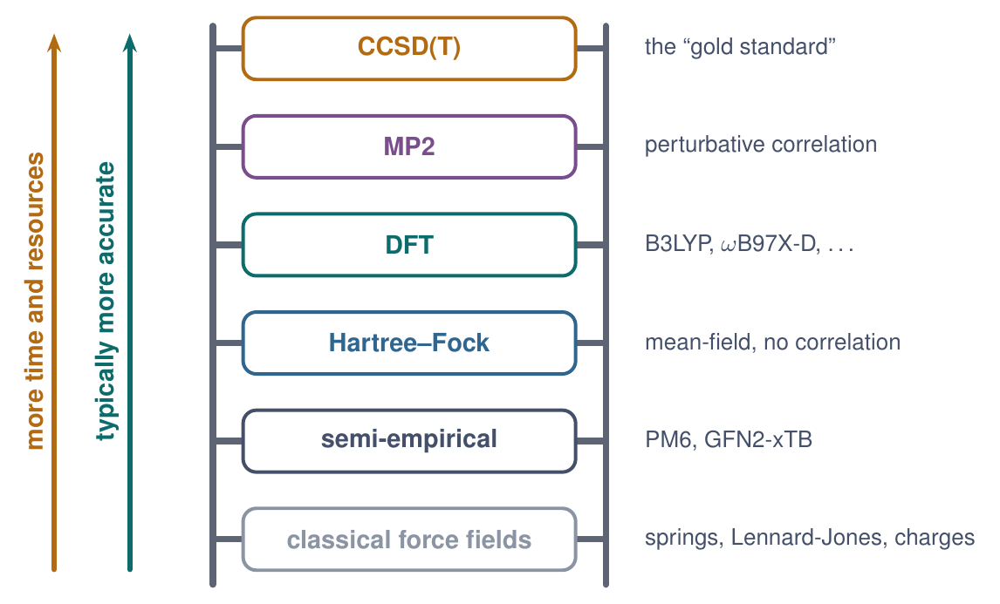
:::

::::

::: {.slide-ref}
S. Chmiela *et al.*, *Sci. Adv.* **3**, e1603015 (2017); C. Bannwarth, S. Ehlert, S. Grimme, *J. Chem. Theory Comput.* **15**, 1652 (2019); D. S. Levine *et al.*, arXiv (2025).
:::

::: {.bridge .fragment}
If these methods already give us energies and forces, why not just keep using them?
:::

## Why we invented semi-empirical methods {data-section="Introduction"}

:::: {.columns}

::: {.column width="48%"}
- Cost grows steeply with size: roughly *N*⁴ for Hartree–Fock, *N*⁵ for MP2, *N*⁷ for CCSD(T)
- Molecular dynamics needs energies and forces at **millions** of time steps
- Semi-empirical methods replaced expensive integrals with **fitted parameters**, trading some accuracy for speed

::: {.key}
Every step down the ladder makes the same trade: accuracy for time and computer resources.
:::
:::

::: {.column width="52%"}
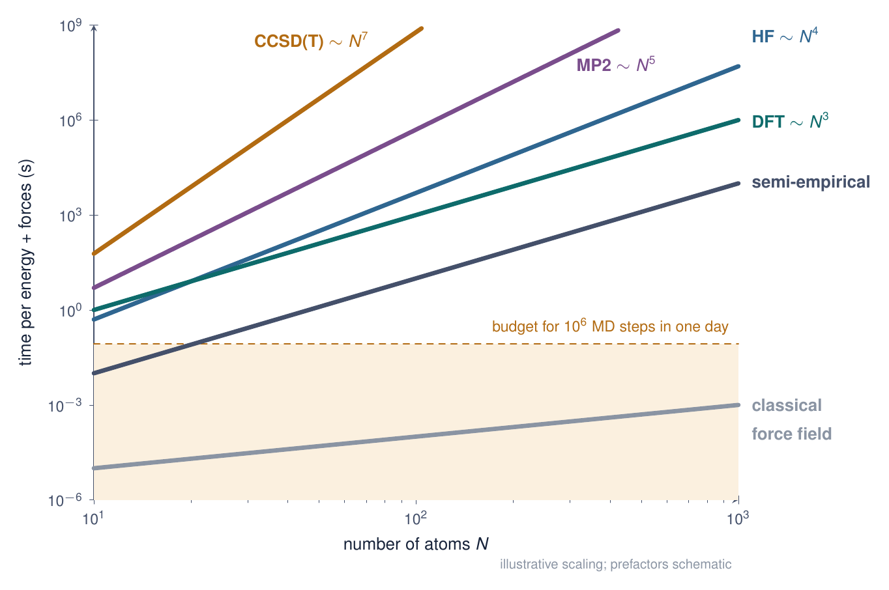
:::

::::

::: {.slide-ref}
M. J. S. Dewar, W. Thiel, *J. Am. Chem. Soc.* **99**, 4899 (1977); W. Thiel, *WIREs Comput. Mol. Sci.* **4**, 145 (2014).
:::

::: {.notes}
Let the room answer "why not keep using them?" before revealing the bullets. They know the answer: cost.
:::

::: {.bridge .fragment}
Machine learning makes a similar trade, by fitting to data. So what kind of method is it?
:::

## Enter machine-learning potentials {data-section="Introduction"}

:::: {.columns .middle}

::: {.column width="48%"}
- Learn from reference calculations **once**
- Then predict energies and forces in milliseconds, close to the accuracy of the reference
- Nanosecond MD at near-reference accuracy becomes routine

::: {.ask}
Is machine learning a numerical, a semi-empirical, or an empirical method?
:::
:::

::: {.column width="52%"}
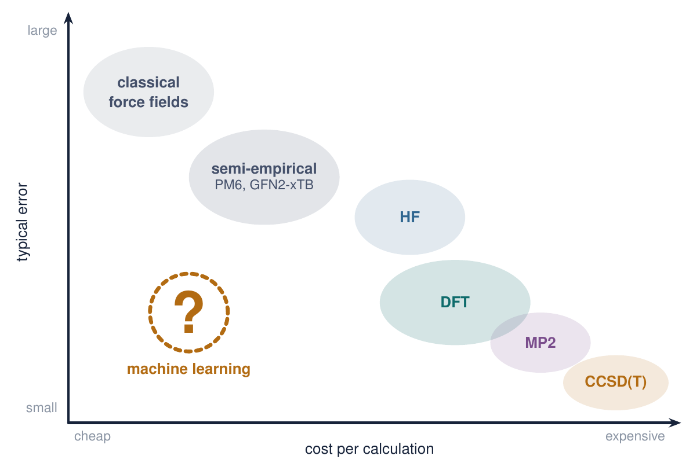
:::

::::

::: {.slide-ref}
J. Behler, M. Parrinello, *Phys. Rev. Lett.* **98**, 146401 (2007); J. Behler, *Chem. Rev.* **121**, 10037 (2021).
:::

::: {.notes}
Don't answer the question. Pause and let them think, then move on.
:::

::: {.bridge .fragment}
Whatever it is, it can learn from huge datasets. What if one model learned all of chemistry?
:::

## Universal models {data-section="Introduction"}

:::: {.columns}

::: {.column width="48%"}
- Train once on **millions** of DFT calculations across chemistry
- One model for many molecules, with no new DFT for each system
- Examples: MACE-OFF, MACE-MP-0, PET-MAD, models trained on SPICE and OMol25

::: {.warn}
The promise: download a model and simulate your molecule. But what has the model actually learned about chemistry?
:::
:::

::: {.column width="52%"}
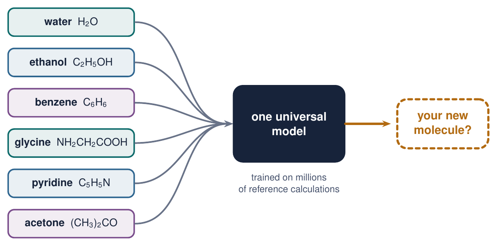
:::

::::

::: {.slide-ref}
I. Batatia *et al.*, *NeurIPS* (2022); D. P. Kovács *et al.*, *J. Am. Chem. Soc.* (2025); P. Eastman *et al.*, *Sci. Data* **10**, 11 (2023); A. Mazitov *et al.*, arXiv (2025).
:::

::: {.notes}
End on the question. This is the bridge to Motivation.
:::

::: {.bridge .fragment}
Even with millions of molecules, what happens where the data runs out?
:::

<!-- ===================== MOTIVATION ===================== -->

## What the data covers {data-section="Motivation"}

:::: {.columns}

::: {.column width="48%"}
- A model is only checked where its training data are
- MD at room temperature samples the energy well densely, and the steep repulsive wall almost never
- On the wall the model has to guess, and it guesses wrong

::: {.key}
High-energy geometries the data does not cover: one kind of out-of-distribution.
:::
:::

::: {.column width="52%"}
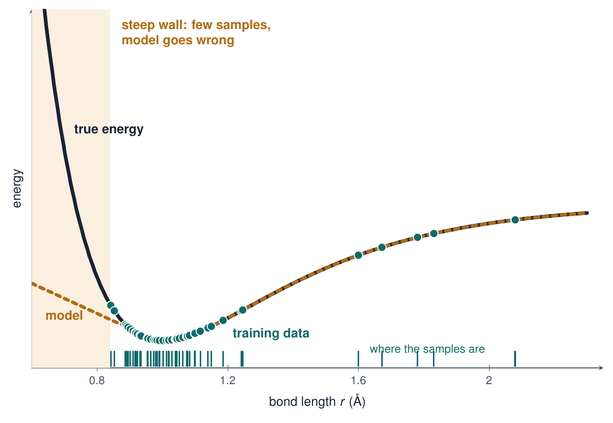
:::

::::

::: {.slide-ref}
J. Behler, *Chem. Rev.* **121**, 10037 (2021); X. Fu *et al.*, *Trans. Mach. Learn. Res.* (2023).
:::

::: {.notes}
Schematic Morse-like curve. The tick marks along the bottom show where the MD samples fall.
:::

::: {.bridge .fragment}
Now think of a reaction. Which point on the path does MD visit least?
:::

## Reactions: the rarest point matters most {data-section="Motivation"}

:::: {.columns}

::: {.column width="48%"}
- MD spends almost all its time in the reactant and product wells
- The **transition state** is visited rarely, so it is barely in the data
- At 298 K, every 1.4 kcal/mol of barrier error is a factor of 10 in the rate

::: {.key}
Rare events the data barely covers: a second kind of out-of-distribution.
:::
:::

::: {.column width="52%"}
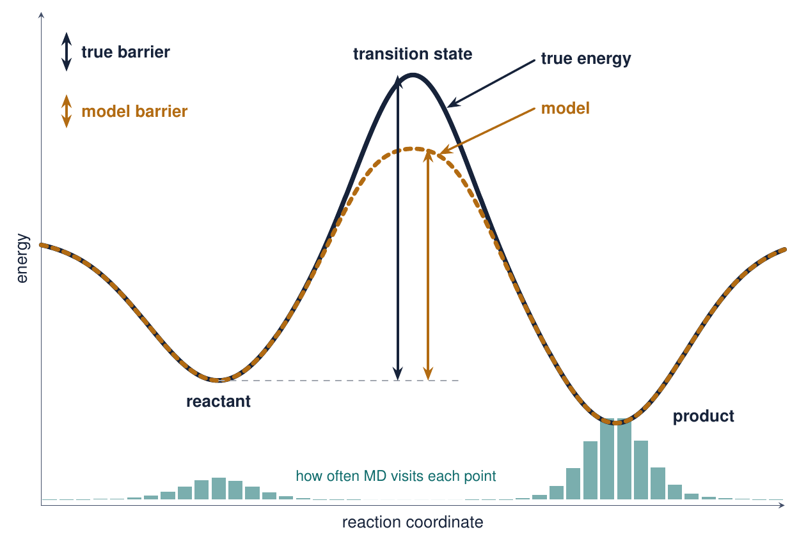
:::

::::

::: {.slide-ref}
H. Eyring, *J. Chem. Phys.* **3**, 107 (1935).
:::

::: {.notes}
From k ∝ exp(−ΔG‡/RT): RT ln 10 ≈ 1.36 kcal/mol at 298 K. Schematic profile.
:::

::: {.bridge .fragment}
Steep walls, rare events... what else counts as out-of-distribution?
:::

## Many ways to be out-of-distribution {data-section="Motivation"}

:::: {.columns}

::: {.column width="50%"}
**Out-of-distribution**: anything the training data does not represent, where the model has to go beyond its data rather than fill in between it.

- High-energy geometries; rare events
- Higher temperature than in training
- Elements, charges or spin states never seen
- Solvent or surfaces, when trained in vacuum
- **A new combination of known groups**
:::

::: {.column width="50%"}
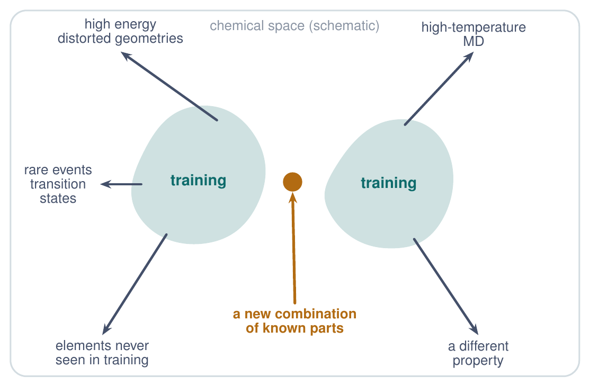
:::

::::

::: {.slide-ref}
S. Chmiela *et al.*, *Sci. Adv.* **3**, e1603015 (2017); X. Fu *et al.*, *Trans. Mach. Learn. Res.* (2023).
:::

::: {.notes}
All but the last change the conditions. The last one changes only the composition: every part is covered, the whole is not.
:::

::: {.bridge .fragment}
That last one is the least tested. What would a test of it look like?
:::

## Our choice: scaffold out-of-distribution {data-section="Motivation"}

:::: {.columns}

::: {.column width="36%"}
- **Fusion**: –OH and C=O seen apart; tested together on one carbon, as –COOH
- **Duplication**: one –COOH seen; tested with two

::: {.key}
Every group is in training; only the molecule is new.
:::
:::

::: {.column width="64%"}
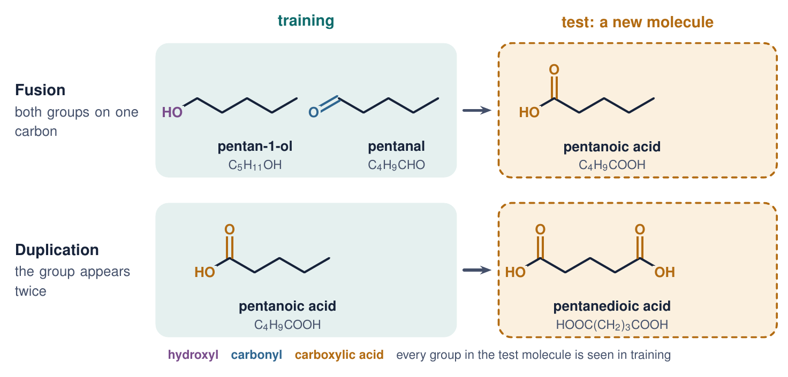
:::

::::

::: {.slide-ref}
G. W. Bemis, M. A. Murcko, *J. Med. Chem.* **39**, 2887 (1996); A. M. Nourollah, I. Khalid, S. Leoni, S. Schockaert, *NeurIPS* (2026), Evaluations & Datasets Track; arXiv:2605.08988.
:::

::: {.notes}
Two of the five GMD tasks, shown as examples; the full set comes in the next section. The question: does a model understand molecules the way we do, from their parts?
:::

::: {.bridge .fragment}
To run this test, we need a dataset built for it. That is GMD.
:::

<!-- ===================== GMD ===================== -->

## GMD: Generalisation for Molecular Dynamics {data-section="GMD"}

:::: {.columns}

::: {.column width="46%"}
- Carbon chains carrying –OH, –CHO, –COOH or –NH~2~
- MD for each molecule, DFT energies and forces for every snapshot
- Training and test sets contain **different molecules**, not just different snapshots

::: {.key}
Usually models are tested on new shapes of known molecules. GMD tests them on new molecules.
:::
:::

::: {.column width="54%"}
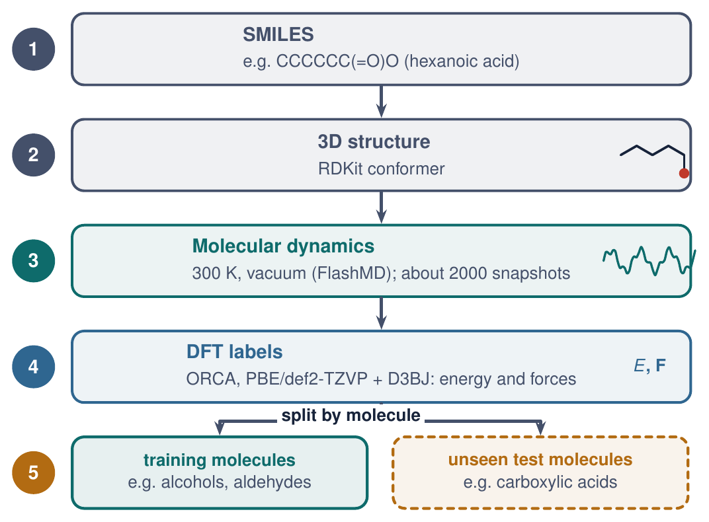
:::

::::

::: {.slide-ref}
A. M. Nourollah, I. Khalid, S. Leoni, S. Schockaert, *NeurIPS* (2026), Evaluations & Datasets Track; arXiv:2605.08988.
:::

::: {.notes}
Data and code are public: huggingface.co/datasets/AmirMasoud/GMD. Each molecule's trajectory has about 2000 snapshots; 140 molecules in total.
:::

::: {.bridge .fragment}
So which new molecules do we test them on?
:::

## Five ways to build a new molecule from known parts {data-section="GMD"}

:::: {.columns}

::: {.column width="58%"}
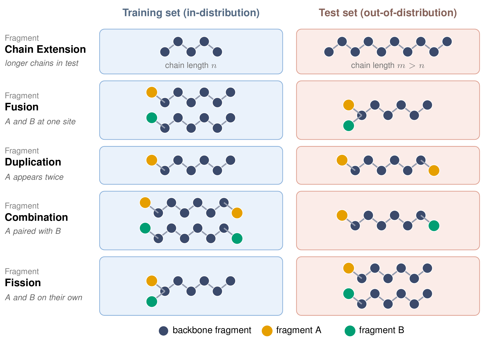{style="height:420px; max-height:420px"}
:::

::: {.column width="42%"}
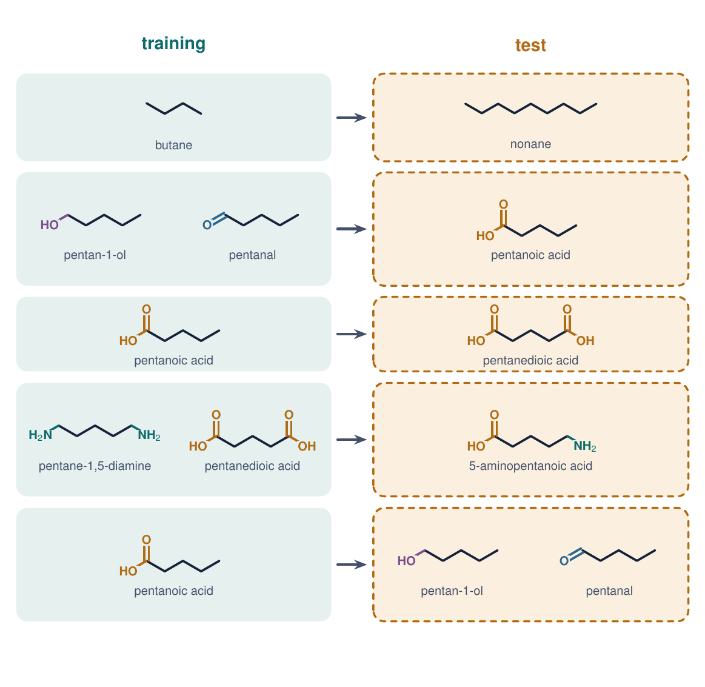{style="height:420px; max-height:420px"}
:::

::::

::: {.slide-ref}
A. M. Nourollah, I. Khalid, S. Leoni, S. Schockaert, *NeurIPS* (2026), Evaluations & Datasets Track; arXiv:2605.08988.
:::

::: {.notes}
Walk down the rows: abstract task on the left, real molecules on the right. Why small molecules: each task changes exactly one thing, so a failure has one cause; every part of a test molecule is in training; chemists can check what a sensible answer looks like; failing the smallest possible step is a strong result.
:::

::: {.bridge .fragment}
So how do today's models do?
:::

<!-- ===================== RESULTS ===================== -->

## Known molecules versus new molecules {data-section="Results"}

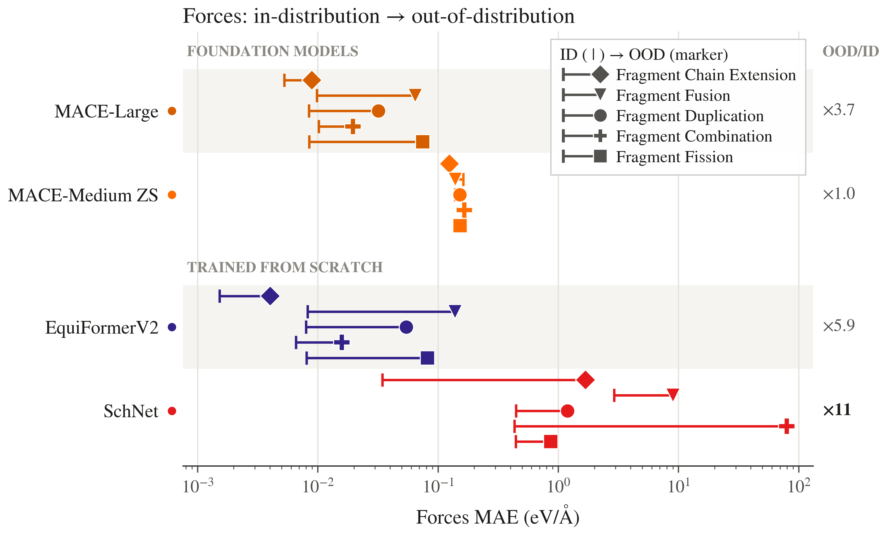{height="435px" fig-align="center"}

::: {.slide-ref}
A. M. Nourollah, I. Khalid, S. Leoni, S. Schockaert, *NeurIPS* (2026), Evaluations & Datasets Track; arXiv:2605.08988.
:::

::: {.notes}
Each bar runs from a model's error on known molecules (|) to its error on new ones, one marker per task; right column is the average OOD/ID ratio. MACE-Medium zero-shot shows ×1.0 only because it is already about ten times worse on known molecules. Energies are worse still: over 1000× on new molecules.
:::

::: {.bridge .fragment}
But where inside the molecule do these errors actually appear?
:::

## Where the failure happens: inside the molecule {data-section="Results"}

:::: {.columns .middle}

::: {.column width="34%"}
- **Hexanoic acid**: new in the fusion task
- Inner disc: error in force **strength**; ring: error in **direction**
- Backbone fine; error on **–COOH**, mostly strength

::: {.warn}
–OH and C=O are known. –COOH is not.
:::
:::

::: {.column width="66%"}
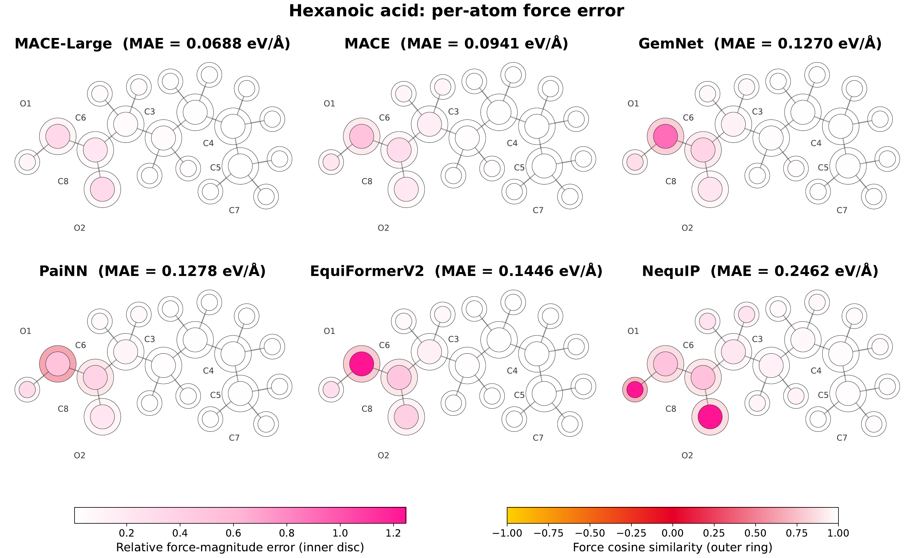
:::

::::

::: {.slide-ref}
A. M. Nourollah, I. Khalid, S. Leoni, S. Schockaert, *NeurIPS* (2026), Evaluations & Datasets Track; arXiv:2605.08988.
:::

::: {.notes}
Each atom's error averaged over 200 test snapshots. NequIP spreads the error over the whole group; others concentrate it on one or two atoms. In the paper, directional errors also localise on the heteroatoms of each task's new environment.
:::

::: {.bridge .fragment}
Combining parts fails badly. How does the simplest task, a longer chain, compare?
:::

## Chain extension: a smaller drop {data-section="Results"}

:::: {.columns}

::: {.column width="40%"}
- Train on ethane to hexane; test on heptane to tridecane
- Errors **still rise** on longer chains, but **far less** than in the other four tasks
- A longer chain adds more CH~2~, nothing chemically new

::: {.key}
**Repeating a known part costs some accuracy. Combining parts in a new way costs far more.**
:::
:::

::: {.column width="60%"}
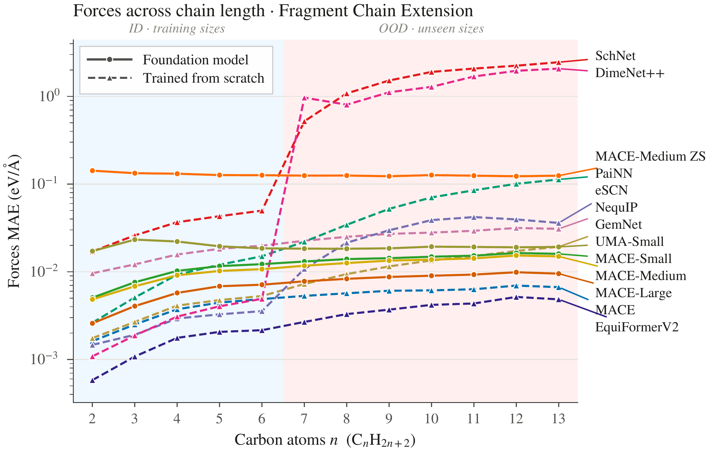
:::

::::

::: {.notes}
SchNet and DimeNet++ are the exceptions: their errors jump by orders of magnitude past hexane.
:::

::: {.slide-ref}
A. M. Nourollah, I. Khalid, S. Leoni, S. Schockaert, *NeurIPS* (2026), Evaluations & Datasets Track; arXiv:2605.08988.
:::

::: {.bridge .fragment}
So what do we take home from all this?
:::

<!-- ===================== TAKEAWAYS ===================== -->

## Takeaways {data-section="Takeaways"}

:::: {.columns}

::: {.column width="54%"}
- **More of the same** (longer chains) costs some accuracy; **known parts in new combinations** cost far more
- Wrong force strengths on a functional group mean wrong vibrations, wrong conformers, wrong barriers
- More data, bigger models and pre-training do not fix it
- Accuracy on known molecules does not predict accuracy on new ones
:::

::: {.column width="46%"}
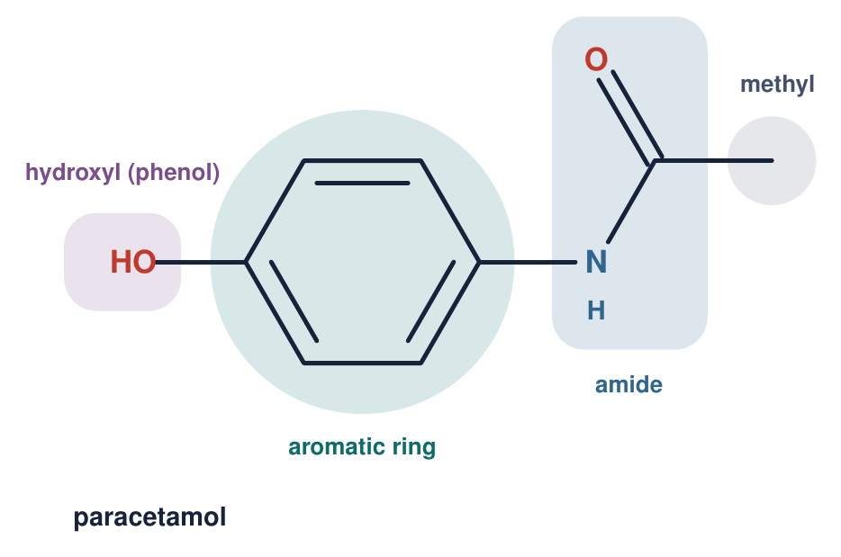
:::

::::

::: {.warn}
Before trusting a model on a new molecule, ask: has it seen this combination, or only these parts?
:::

::: {.slide-ref}
A. M. Nourollah, I. Khalid, S. Leoni, S. Schockaert, *NeurIPS* (2026), Evaluations & Datasets Track; arXiv:2605.08988.
:::

::: {.notes}
Call back to the first slides: every molecule you care about is a new combination of familiar parts. Details on data and model size are in the appendix.
:::

## Thank you {.closing data-section="Takeaways"}

:::: {.columns .middle}

::: {.column width="50%"}
**Amir Masoud Nourollah**

Stefano Leoni · Steven Schockaert

Paper: arXiv:2605.08988 (NeurIPS 2026)

Data: huggingface.co/datasets/AmirMasoud/GMD

Code: github.com/Nourollah/GMD-26

::: {.key}
Questions?
:::
:::

::: {.column width="50%"}

:::

::::

<!-- ===================== APPENDIX ===================== -->

## Not a data or model-size problem {data-section="Appendix"}

:::: {.columns}

::: {.column width="50%"}
### More data
Foundation models pre-trained on millions of structures (MACE-MP-0, UMA) do not consistently beat MACE trained from scratch on GMD.

### Bigger models
A larger MACE-MP-0 helps on some tasks, but the gap stays.
:::

::: {.column width="50%"}
### More training coverage
Adding related molecules to the training set does not close the gap for fusion.

### Another level of theory
GFN2-xTB labels instead of DFT give the same pattern.
:::

::::

::: {.warn}
Fine-tuning fixes the molecules the model was shown, not the ones it wasn't.
:::

::: {.slide-ref}
A. M. Nourollah, I. Khalid, S. Leoni, S. Schockaert, *NeurIPS* (2026), Evaluations & Datasets Track; arXiv:2605.08988.
:::

::: {.notes}
Paper Section 4.3 and Appendices A.3 and C.2. Foundation models were fine-tuned for 2000 epochs per task, an upper bound on what fine-tuning can do.
:::

## Future work {data-section="Appendix"}

:::: {.columns}

::: {.column width="50%"}
### What I am working on
- A model whose learning is guided by chemical structure
- It is forced to see a molecule the way a chemist does: as functional groups and how they connect
:::

::: {.column width="50%"}

:::

::::

::: {.key}
Goal: a model that understands a new molecule from its parts.
:::

::: {.slide-ref}
A. M. Nourollah, I. Khalid, S. Leoni, S. Schockaert, *NeurIPS* (2026), Evaluations & Datasets Track; arXiv:2605.08988.
:::

## Fitting well is not generalising well {data-section="Appendix"}

:::: {.columns}

::: {.column width="48%"}
- Two kinds of points: the model learns a **border** between them
- A straight line misses a few training points, but gets new points right
- A wiggly border gets **every** training point right, and new points wrong

::: {.key}
We want a model that works on data it has never seen, not one that remembers its training data. That is **generalisation**.
:::
:::

::: {.column width="52%"}
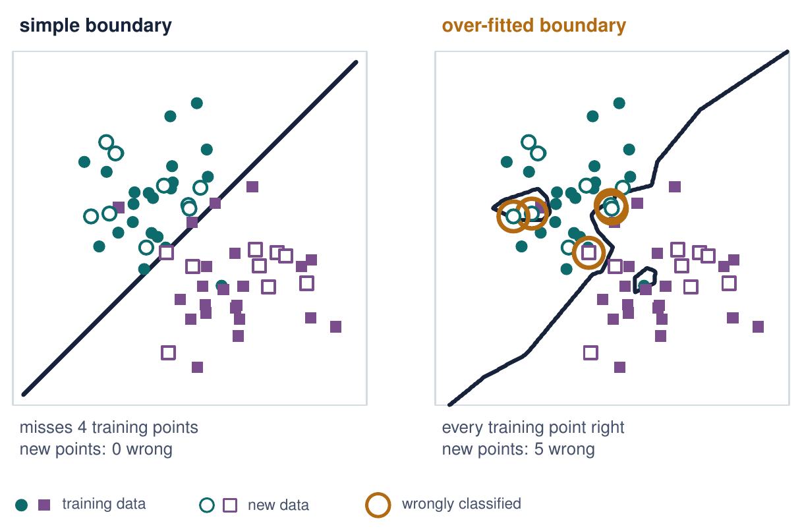
:::

::::

::: {.slide-ref}
C. M. Bishop, *Pattern Recognition and Machine Learning*, Springer (2006), §1.1, §4.1.
:::

::: {.notes}
Point at the circled new points on the right panel. The over-fitted model "learned" the noise.
:::

::: {.bridge .fragment}
What about points that land outside everything the model has seen, or outside what our data covers?
:::
