## Overview {data-section="Overview"}

:::: {.columns .middle}

::: {.column width="46%"}
1. **Introduction**: compositional generalisation, and why molecules are a clean test for it
2. **Motivation**: how ML potentials are tested today, and what is missing
3. **GMD: the benchmark**: known parts, new molecules
4. **Results**: 13 models, five tasks, one failure mode
5. **Takeaways** and what comes next
:::

::: {.column width="54%"}
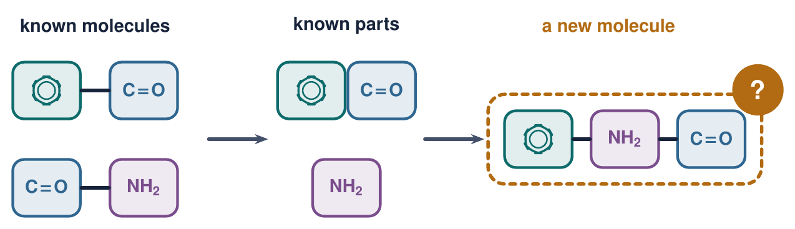
:::

::::

::: {.bridge .fragment}
Let's start with a question ML has asked for years: can models recombine what they know?
:::

<!-- ===================== INTRODUCTION ===================== -->

## Compositional generalisation {data-section="Introduction"}

:::: {.columns}

::: {.column width="44%"}
- Train on the parts, test on **new combinations** of them
- A model that knows *jump* and *walk twice* should handle *jump twice*
- Standard models often fail: SCAN and COGS in language, CLEVR-CoGenT in vision

::: {.key}
Most of these tests use synthetic tasks, where "correct" is defined by a grammar we wrote.
:::
:::

::: {.column width="56%"}
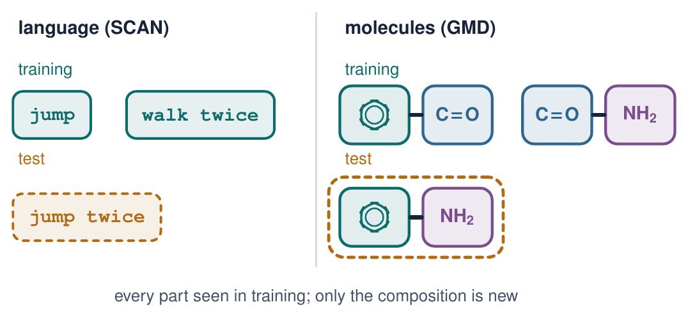
:::

::::

::: {.slide-ref}
B. Lake, M. Baroni, *ICML* (2018); N. Kim, T. Linzen, *EMNLP* (2020); J. Johnson *et al.*, *CVPR* (2017).
:::

::: {.bridge .fragment}
Is there a domain that is compositional by nature, with ground truth given by physics?
:::

## Molecules are compositional by construction {data-section="Introduction"}

:::: {.columns}

::: {.column width="48%"}
- Chemists read a molecule as **parts**: functional groups, rings, chains
- Parts carry their behaviour with them, which is why chemists can reason about molecules they have never met
- And the "correct answer" is not a rule we invented: it is quantum mechanics

::: {.key}
Molecules are a natural testbed for compositional generalisation, with physically exact labels.
:::
:::

::: {.column width="52%"}
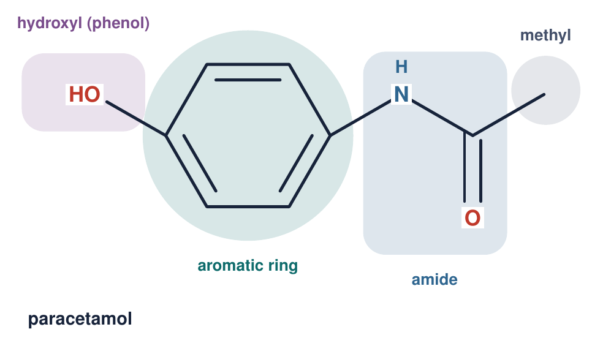
:::

::::

::: {.slide-ref}
S. W. Benson, J. H. Buss, *J. Chem. Phys.* **29**, 546 (1958).
:::

::: {.bridge .fragment}
So what does an ML model actually learn about a molecule?
:::

## Machine-learning interatomic potentials {data-section="Introduction"}

:::: {.columns}

::: {.column width="48%"}
- **Input**: element and 3D position of every atom
- **Output**: energy *E* and forces **F**~*i*~ = −∂*E*/∂**r**~*i*~
- Each atom sees a **local neighbourhood**; *E* is a sum over atoms
- Mostly equivariant GNNs: NequIP, MACE, EquiFormerV2

::: {.key}
The architecture is built from local parts, so compositional generalisation looks like it should come for free.
:::
:::

::: {.column width="52%"}
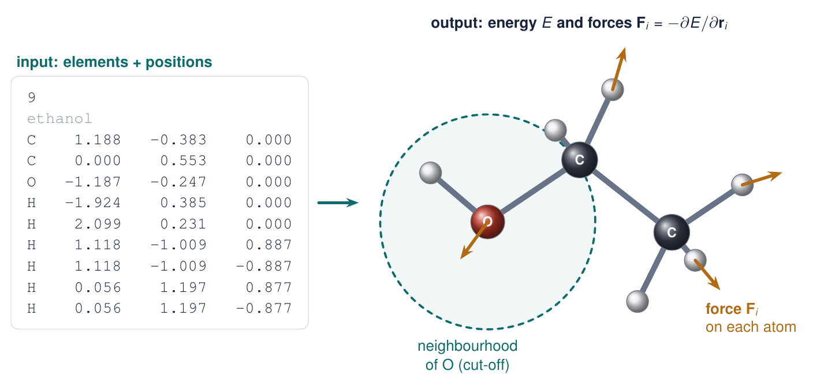
:::

::::

::: {.slide-ref}
J. Behler, M. Parrinello, *Phys. Rev. Lett.* **98**, 146401 (2007); I. Batatia *et al.*, *NeurIPS* (2022).
:::

::: {.bridge .fragment}
But why learn energies at all, instead of computing them?
:::

## Labels are expensive {data-section="Introduction"}

:::: {.columns}

::: {.column width="48%"}
- Reference labels come from quantum chemistry: DFT scales roughly as *N*^3^, coupled cluster as *N*^7^
- Molecular dynamics needs 10^6^ or more energy and force evaluations
- An MLIP pays the DFT cost once, at training time, then runs close to the speed of a classical force field

::: {.key}
MLIPs amortise quantum chemistry. Their value depends entirely on how far they transfer.
:::
:::

::: {.column width="52%"}
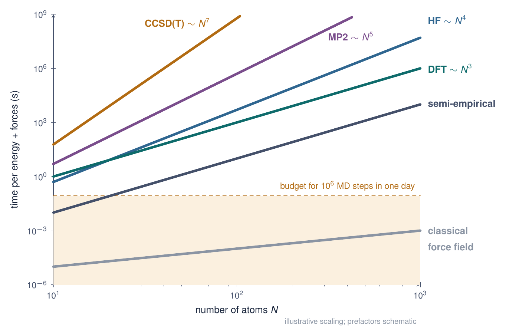
:::

::::

::: {.slide-ref}
J. Behler, *Chem. Rev.* **121**, 10037 (2021).
:::

::: {.bridge .fragment}
If labels are this expensive, why not pay once, at scale, for all of chemistry?
:::

## Foundation models for atoms {data-section="Introduction"}

:::: {.columns}

::: {.column width="48%"}
- More DFT calculations, bigger datasets: MPtrj (materials), OMol25 (molecules, 100M+ calculations)
- Pre-train once on millions of structures, then fine-tune or use zero-shot
- Examples: MACE-MP-0, UMA, PET-MAD

::: {.warn}
The assumption: they learn chemistry itself. Or do they stay grounded in what they have seen?
:::
:::

::: {.column width="52%"}
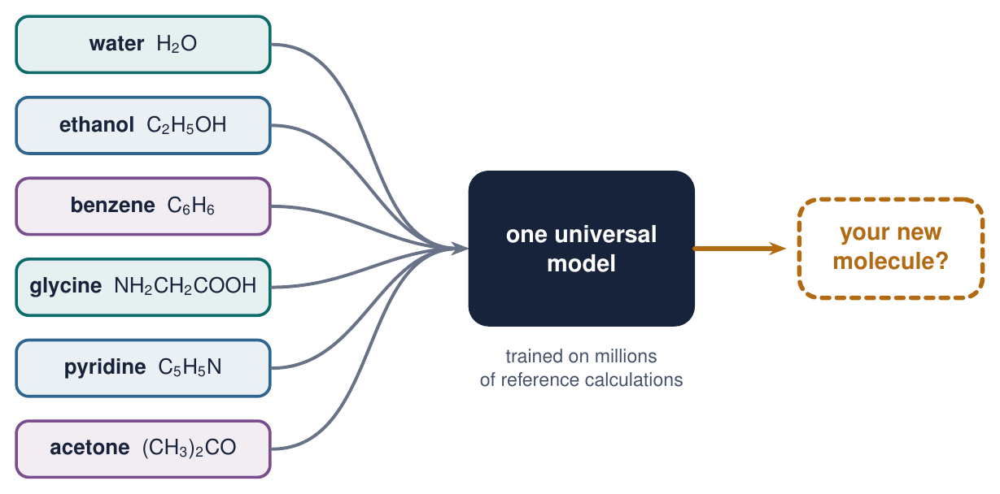
:::

::::

::: {.slide-ref}
I. Batatia *et al.*, arXiv:2401.00096 (2023); D. S. Levine *et al.*, arXiv (2025); A. Mazitov *et al.*, arXiv (2025).
:::

::: {.bridge .fragment}
So how is out-of-distribution performance tested for these models today?
:::

<!-- ===================== MOTIVATION ===================== -->

## How MLIPs are tested out-of-distribution {data-section="Motivation"}

:::: {.columns}

::: {.column width="48%"}
- Random splits of MD trajectories: test frames are near-duplicates of training frames
- Shifts in **conditions**: high temperature, distorted geometries, rare events, unseen elements
- Scaffold splits exist for molecular **property prediction**, but not for potentials

::: {.key}
Missing: a controlled shift in **composition**, where every part is seen and only the whole is new.
:::
:::

::: {.column width="52%"}
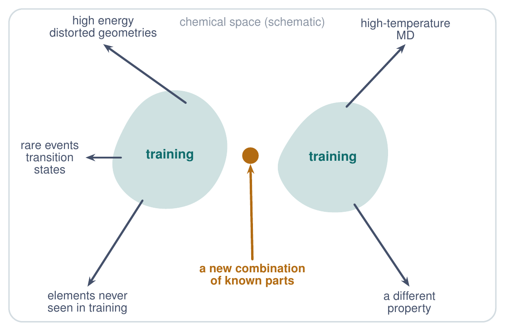
:::

::::

::: {.slide-ref}
S. Chmiela *et al.*, *Sci. Adv.* **3**, e1603015 (2017); X. Fu *et al.*, *TMLR* (2023); Z. Wu *et al.*, *Chem. Sci.* **9**, 513 (2018).
:::

::: {.bridge .fragment}
What would such a test look like for a potential?
:::

## The question {data-section="Motivation"}

:::: {.columns}

::: {.column width="48%"}
- **Train** on molecules built from fragments A, B and C
- **Test** on new molecules that join the same fragments in a new way
- A model that learned transferable local chemistry should find this easy

::: {.warn}
Do MLIPs generalise compositionally, or do they memorise the molecules they were trained on?
:::
:::

::: {.column width="52%"}
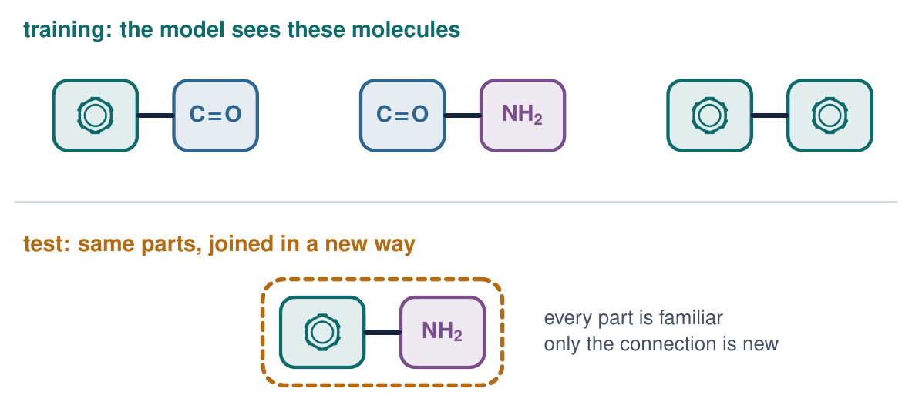
:::

::::

::: {.slide-ref}
G. W. Bemis, M. A. Murcko, *J. Med. Chem.* **39**, 2887 (1996); Z. Wu *et al.*, *Chem. Sci.* **9**, 513 (2018).
:::

::: {.bridge .fragment}
To answer this cleanly, we built a benchmark for it.
:::

<!-- ===================== GMD ===================== -->

## GMD: Generalisation for Molecular Dynamics {data-section="GMD"}

:::: {.columns}

::: {.column width="46%"}
- 140 molecules in 12 families, built from H, C, N and O
- 300 K MD for each molecule, DFT energies and forces for every snapshot: about 280,000 labelled configurations
- Splits are **by molecule**, never by snapshot

::: {.key}
Open data and code: huggingface.co/datasets/AmirMasoud/GMD
:::
:::

::: {.column width="54%"}
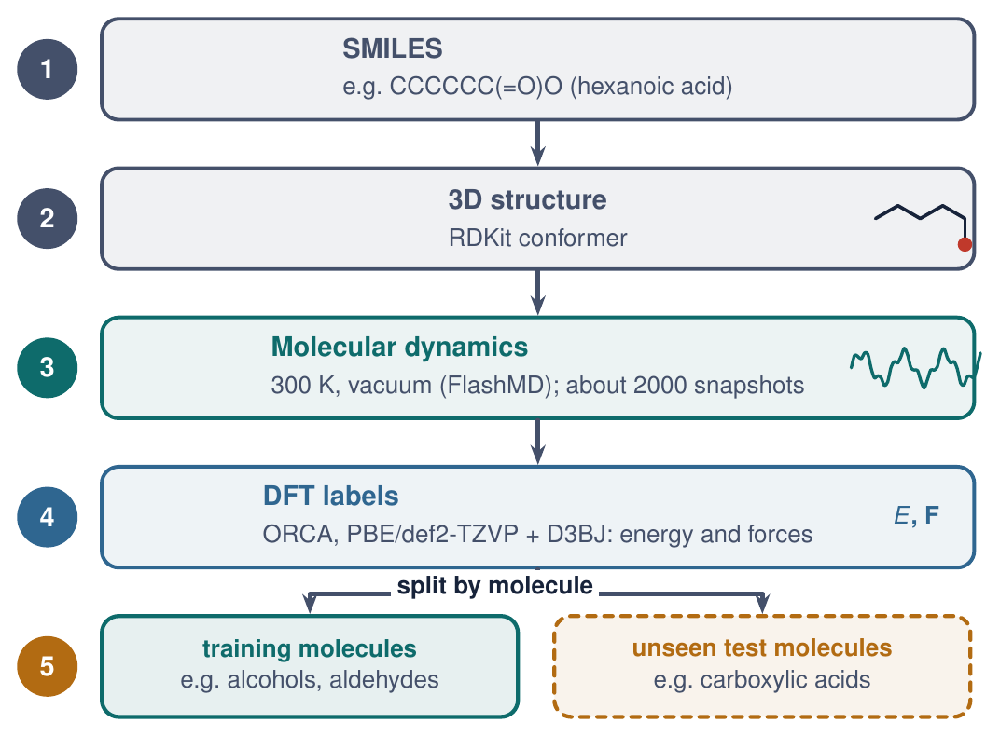
:::

::::

::: {.slide-ref}
A. M. Nourollah, I. Khalid, S. Leoni, S. Schockaert, *NeurIPS* (2026), Evaluations & Datasets Track; arXiv:2605.08988.
:::

::: {.bridge .fragment}
Which compositional operations do we test?
:::

## Five compositional operations {data-section="GMD"}

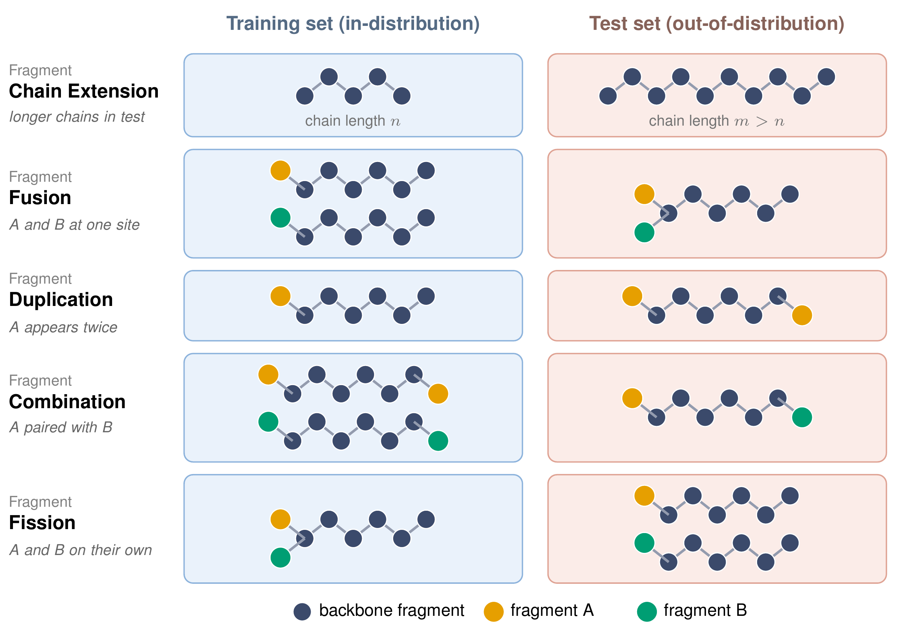{height="365px" fig-align="center"}

::: {.small style="text-align:center"}
Each task isolates one operation; every fragment in a test molecule appears in training.
:::

::: {.slide-ref}
A. M. Nourollah, I. Khalid, S. Leoni, S. Schockaert, *NeurIPS* (2026), Evaluations & Datasets Track; arXiv:2605.08988.
:::

::: {.notes}
Chain extension is the length-generalisation analogue; fusion, duplication, combination and fission are the compositional ones.
:::

::: {.bridge .fragment}
Why such small molecules?
:::

## Design choices {data-section="GMD"}

:::: {.columns}

::: {.column width="48%"}
- **One operation per task**: a failure has one cause
- **Minimal shift**: failing the smallest step is a strong negative result
- **Consistent labels**: one DFT level, cheap enough for many models
- **Controls**: augmented training sets and GFN2-xTB labels
:::

::: {.column width="52%"}
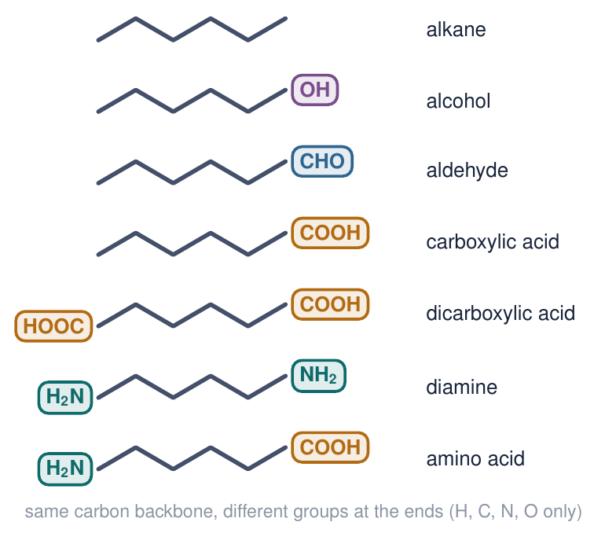
:::

::::

::: {.slide-ref}
A. M. Nourollah, I. Khalid, S. Leoni, S. Schockaert, *NeurIPS* (2026), Evaluations & Datasets Track; arXiv:2605.08988.
:::

::: {.bridge .fragment}
Which models did we put through this?
:::

## Models and protocol {data-section="GMD"}

:::: {.columns}

::: {.column width="50%"}
### Trained from scratch
SchNet, DimeNet++, GemNet, PaiNN, NequIP, MACE, eSCN, EquiFormerV2: invariant to fully equivariant, 2017 to 2024

### Foundation models
MACE-MP-0 Small, Medium and Large and UMA-Small, fine-tuned per task; MACE-MP-0 Medium zero-shot
:::

::: {.column width="50%"}
### Metrics
Energy and force MAE against DFT, on known molecules (ID) and new molecules (OOD)

### Headline number
OOD/ID error ratio per model, averaged over tasks

::: {.notes}
Foundation models fine-tuned for 2000 epochs per task: an upper bound on what fine-tuning can do. [Check seeds and error bars before the talk.]
:::
:::

::::

::: {.slide-ref}
A. M. Nourollah, I. Khalid, S. Leoni, S. Schockaert, *NeurIPS* (2026), Evaluations & Datasets Track; arXiv:2605.08988.
:::

::: {.bridge .fragment}
So what happens on new molecules?
:::

<!-- ===================== RESULTS ===================== -->

## Every model degrades on new compositions {data-section="Results"}

:::: {.columns .middle}

::: {.column width="44%"}
- Each bar runs from ID error (|) to OOD error, one marker per task
- Force errors grow ×1 to ×19 on average; energy errors can grow over 1000×
- Fusion, duplication and fission are hardest; chain extension (◆) is easiest
- The best ID model is not always the best OOD
:::

::: {.column width="56%"}
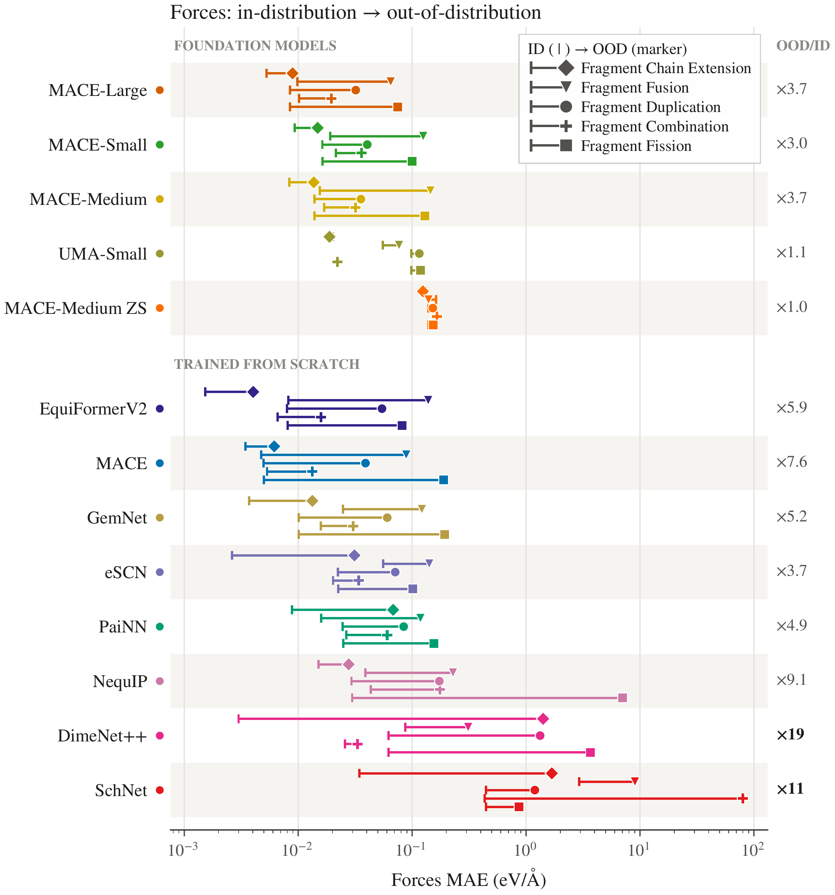{style="max-height:465px"}
:::

::::

::: {.slide-ref}
A. M. Nourollah, I. Khalid, S. Leoni, S. Schockaert, *NeurIPS* (2026), Evaluations & Datasets Track; arXiv:2605.08988.
:::

::: {.notes}
MACE-Medium zero-shot has a ratio near ×1 only because its ID error is already high. In-distribution accuracy is a poor proxy for compositional generalisation.
:::

::: {.bridge .fragment}
Where inside a molecule does the error appear?
:::

## The error localises on the new composition {data-section="Results"}

:::: {.columns .middle}

::: {.column width="34%"}
- **Hexanoic acid**, OOD in fusion: trained on alcohols and aldehydes
- Inner disc: force-**magnitude** error; ring: **direction** error
- Backbone is fine; error sits on **–COOH**, and it is mostly magnitude

::: {.warn}
Known: –OH and C=O. Not composed: –COOH.
:::
:::

::: {.column width="66%"}
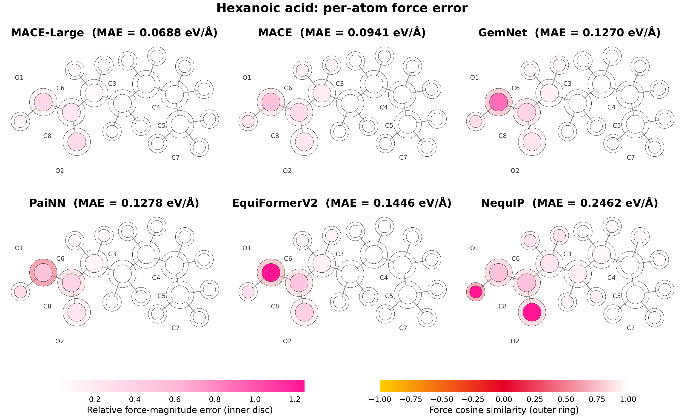
:::

::::

::: {.slide-ref}
A. M. Nourollah, I. Khalid, S. Leoni, S. Schockaert, *NeurIPS* (2026), Evaluations & Datasets Track; arXiv:2605.08988.
:::

::: {.notes}
Per-atom errors averaged over 200 test snapshots. NequIP spreads the error over the group; the others concentrate it on one or two atoms.
:::

::: {.bridge .fragment}
Is length generalisation any easier than composition?
:::

## Chain extension: length generalisation is easier {data-section="Results"}

:::: {.columns}

::: {.column width="40%"}
- Train on C~2~ to C~6~ alkanes; test on C~7~ to C~13~
- Errors still rise with length, but far less than in the compositional tasks
- SchNet and DimeNet++ break down past the training lengths

::: {.key}
Repeating a known part costs some accuracy. Composing parts in a new way costs far more.
:::
:::

::: {.column width="60%"}
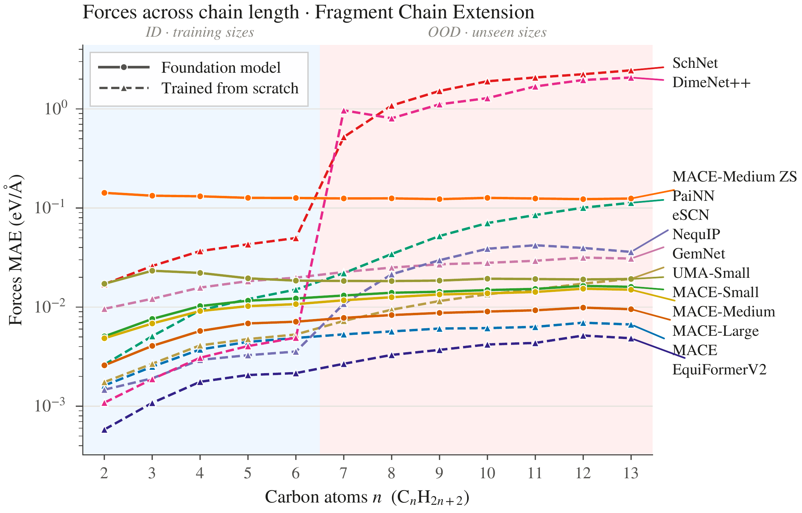
:::

::::

::: {.slide-ref}
A. M. Nourollah, I. Khalid, S. Leoni, S. Schockaert, *NeurIPS* (2026), Evaluations & Datasets Track; arXiv:2605.08988.
:::

::: {.bridge .fragment}
Could more data, bigger models or pre-training close the gap?
:::

## Not a data, scale or label problem {data-section="Results"}

:::: {.columns}

::: {.column width="50%"}
### Pre-training
Foundation models pre-trained on millions of structures do not consistently beat MACE trained from scratch on GMD

### Scale
Larger MACE-MP-0 helps on some tasks; the OOD gap remains
:::

::: {.column width="50%"}
### Coverage
Augmented training sets do not close the gap on fusion

### Labels
GFN2-xTB labels instead of DFT give the same pattern
:::

::::

::: {.warn}
Fine-tuning fixes the molecules the model was shown, not the ones it was not.
:::

::: {.slide-ref}
A. M. Nourollah, I. Khalid, S. Leoni, S. Schockaert, *NeurIPS* (2026), Evaluations & Datasets Track; arXiv:2605.08988.
:::

::: {.bridge .fragment}
So what does this mean for how we build and evaluate MLIPs?
:::

<!-- ===================== TAKEAWAYS ===================== -->

## Takeaways and future work {data-section="Takeaways"}

:::: {.columns}

::: {.column width="50%"}
### What we found
- Locality in the architecture does not give compositional generalisation
- Scale, pre-training and fine-tuning do not either
- ID accuracy is a poor proxy for OOD accuracy
- Random-split evaluations hide this failure
:::

::: {.column width="50%"}
### What I am working on
- An inductive bias that controls **how** the model learns a molecule
- Forcing it to represent molecules through their functional groups and how they connect

::: {.key}
GMD gives a cheap, exact testbed for any such idea.
:::
:::

::::

::: {.slide-ref}
A. M. Nourollah, I. Khalid, S. Leoni, S. Schockaert, *NeurIPS* (2026), Evaluations & Datasets Track; arXiv:2605.08988.
:::

## Thank you {.closing data-section="Takeaways"}

:::: {.columns .middle}

::: {.column width="50%"}
**Amir Masoud Nourollah**

Paper: arXiv:2605.08988 (NeurIPS 2026)

Data: huggingface.co/datasets/AmirMasoud/GMD

Code: github.com/Nourollah/GMD-26

::: {.key}
Questions?
:::
:::

::: {.column width="50%"}

:::

::::

<!-- ===================== BACKUP ===================== -->

## Backup: are the test environments really local repeats? {data-section="Takeaways"}

:::: {.columns}

::: {.column width="50%"}
- The obvious question from an ML audience: with a cut-off of [r~c~] Å, does every OOD local environment appear in training?
- [Answer from the paper: share of OOD atom environments within the cut-off that have a close match in training]
:::

::: {.column width="50%"}
::: {.img-slot}
Image: local-environment coverage

[If the paper has it: nearest-training-neighbour distance of each OOD atomic environment, for each task.]

`env_coverage.png`
:::
:::

::::

::: {.slide-ref}
A. M. Nourollah, I. Khalid, S. Leoni, S. Schockaert, *NeurIPS* (2026), Evaluations & Datasets Track; arXiv:2605.08988.
:::
