## Overview {data-section="Overview"}

:::: {.columns .middle}

::: {.column width="64%"}
1. **Introduction**: two fields, one question
2. **Background**: how machines learn about molecules
3. **Motivation**: where the data runs out
4. **GMD**: a benchmark for known parts in new molecules
5. **Results**: where and why models fail
6. **Takeaways** and what comes next
:::

::: {.column width="36%"}
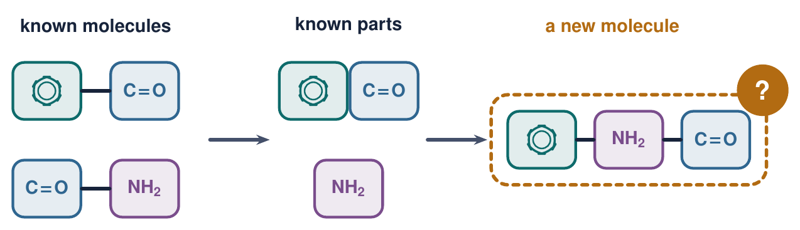
:::

::::

::: {.notes}
Mixed room: say up front that every concept gets a chemistry view and a machine-learning view.
:::

::: {.bridge .fragment}
Let's start with something every chemist does without thinking: reading a molecule.
:::

<!-- ===================== INTRODUCTION ===================== -->

## How a chemist reads a molecule {data-section="Introduction"}

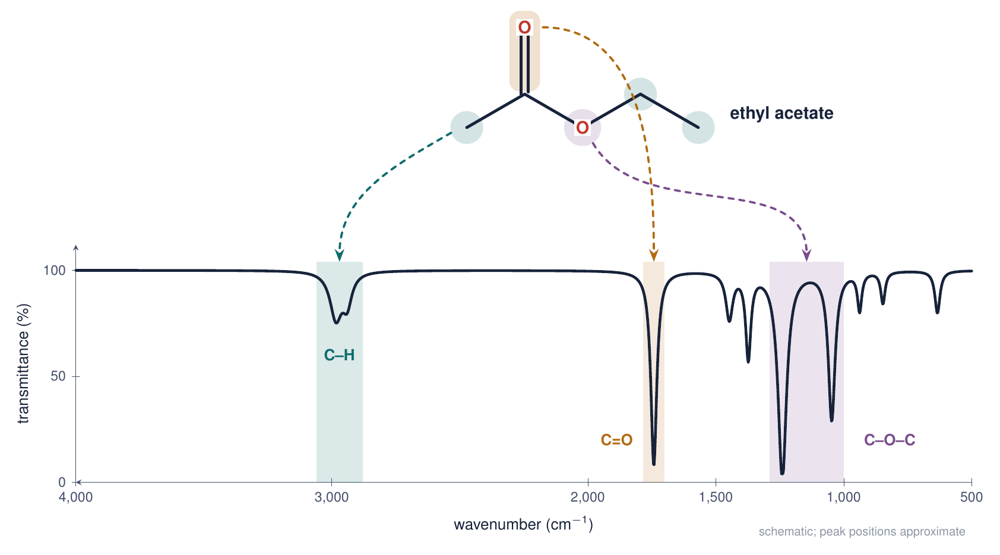{height="430px" fig-align="center"}

::: {.slide-ref}
G. Socrates, *Infrared and Raman Characteristic Group Frequencies*, 3rd ed., Wiley (2001); S. W. Benson, J. H. Buss, *J. Chem. Phys.* **29**, 546 (1958).
:::

::: {.notes}
We read a molecule as parts, and so does experiment: each group of ethyl acetate has its own peak (C–H near 2980, C=O near 1740, C–O–C near 1240 and 1050 cm⁻¹). Properties are close to additive, which is why group-additivity schemes work. Schematic spectrum.
:::

::: {.bridge .fragment}
Machine learning has a name for this ability. What is it, and do models have it?
:::

## Compositional generalisation {data-section="Introduction"}

:::: {.columns}

::: {.column width="44%"}
- Learn the parts, then handle **new combinations** of them
- Knowing *jump* and *walk twice* should give *jump twice*
- Standard models often fail: SCAN, COGS in language; CLEVR-CoGenT in vision

::: {.key}
Chemists do this every day. For ML it is still an open problem.
:::
:::

::: {.column width="56%"}
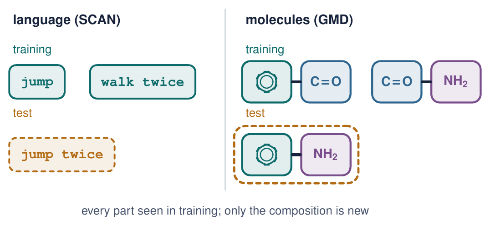
:::

::::

::: {.slide-ref}
B. Lake, M. Baroni, *ICML* (2018); N. Kim, T. Linzen, *EMNLP* (2020); J. Johnson *et al.*, *CVPR* (2017).
:::

::: {.notes}
For chemists: SCAN is a toy language of commands. For ML people: molecules give the same test, with quantum mechanics as the ground truth instead of a grammar.
:::

::: {.bridge .fragment}
Before asking whether ML models do this for molecules: how does a machine learn anything at all?
:::

<!-- ===================== BACKGROUND ===================== -->

## Teaching a computer from examples {data-section="Background"}

:::: {.columns}

::: {.column width="48%"}
- We give the computer **examples**: inputs and the correct answers
- It tunes a flexible formula until its predictions match those answers
- "Learning" means finding the parameters with the smallest error

::: {.key}
You already do this: fit a curve to two or three experimental points, then predict other amounts of reactant without running more experiments.
:::
:::

::: {.column width="52%"}
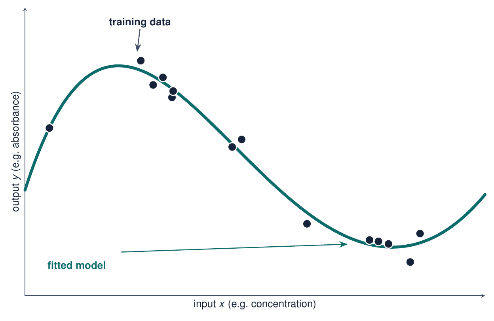
:::

::::

::: {.slide-ref}
C. M. Bishop, *Pattern Recognition and Machine Learning*, Springer (2006), ch. 1.
:::

::: {.bridge .fragment}
Can we trust that curve everywhere, even far from the points we measured?
:::

## Inside the data versus outside it {data-section="Background"}

:::: {.columns}

::: {.column width="48%"}
- Between known points the model **interpolates**, and is usually reliable
- Beyond them it **extrapolates**, and nothing in the training checks it
- Models that agree inside the data can disagree wildly outside it

::: {.key}
A small training error says little about data the model has never seen.
:::
:::

::: {.column width="52%"}
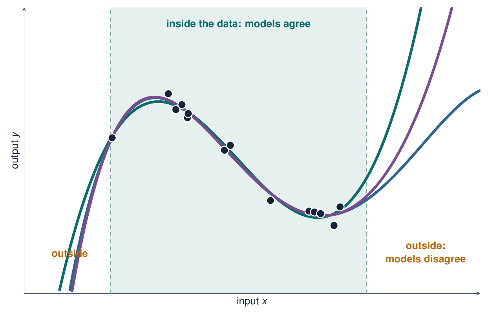
:::

::::

::: {.slide-ref}
C. M. Bishop, *Pattern Recognition and Machine Learning*, Springer (2006), §1.1, §3.2.
:::

::: {.bridge .fragment}
Let's see how different our interpretation of a molecule is from a computer's.
:::

## What does a molecule look like to a computer? {data-section="Background"}

:::: {.columns}

::: {.column width="48%"}
- **Input**: each atom's element and 3D position, exactly what an `.xyz` file holds
- **Output**: the energy *E*, and the force on every atom
- There are many ways to give a molecule to a computer: 3D coordinates, adjacency matrices, molecular graphs, SMILES strings, fingerprints

::: {.key}
The model never sees a label like "carbonyl": only elements and distances.
:::
:::

::: {.column width="52%"}
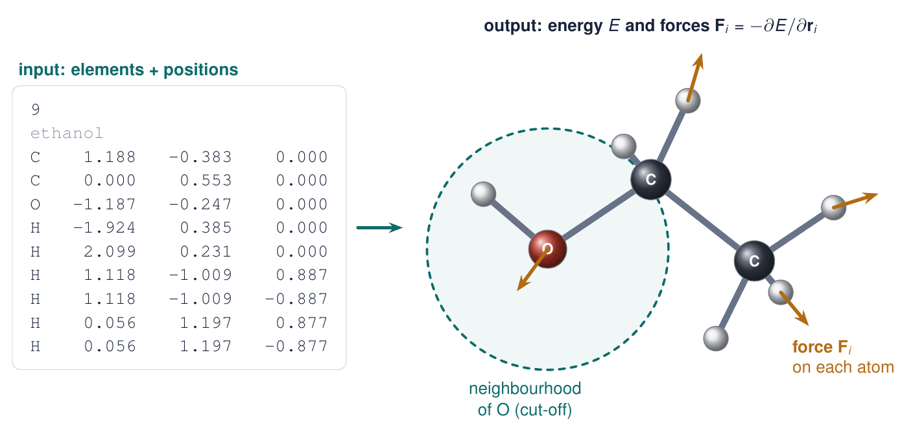
:::

::::

::: {.slide-ref}
J. Behler, M. Parrinello, *Phys. Rev. Lett.* **98**, 146401 (2007); I. Batatia *et al.*, *NeurIPS* (2022).
:::

::: {.notes}
For ML people: these are equivariant graph neural networks (NequIP, MACE, EquiFormerV2). For chemists: the symmetry is built in, not learned.
:::

::: {.bridge .fragment}
Then does machine learning read molecules the way a chemist does?
:::

## Does machine learning read molecules this way? {data-section="Background"}

:::: {.columns}

::: {.column width="48%"}
- The model learns from whole molecules, one geometry at a time
- Nothing forces it to learn "parts" the way a chemist does
- It might learn rules, or it might memorise the molecules it was shown

::: {.warn}
If every part of a new molecule is familiar, does the model find the whole familiar?
:::
:::

::: {.column width="52%"}
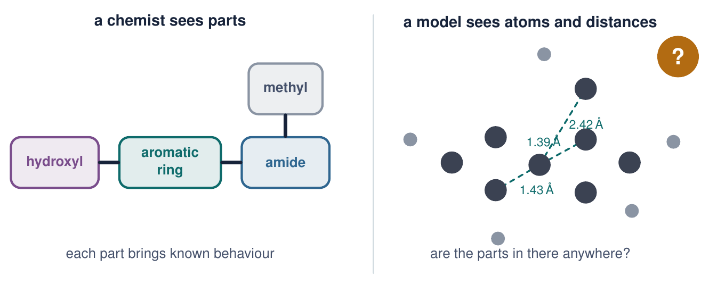
:::

::::

::: {.slide-ref}
B. Lake, M. Baroni, *ICML* (2018).
:::

::: {.bridge .fragment}
Where to get these data, and how?
:::

## Any method can supply the data and become a teacher {data-section="Background"}

:::: {.columns}

::: {.column width="48%"}
- From CCSD(T) to GFN2-xTB, every method gives energies and forces for a geometry
- So **any** of them can supply training data
- Datasets range from ten small molecules (MD17) to over 100 million calculations (OMol25)

::: {.key}
A model is at best as accurate as the method that produced its data.
:::
:::

::: {.column width="52%"}
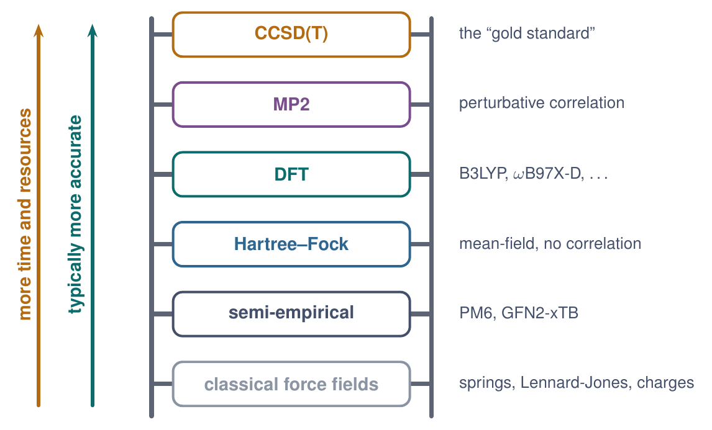
:::

::::

::: {.slide-ref}
S. Chmiela *et al.*, *Sci. Adv.* **3**, e1603015 (2017); C. Bannwarth, S. Ehlert, S. Grimme, *J. Chem. Theory Comput.* **15**, 1652 (2019); D. S. Levine *et al.*, arXiv (2025).
:::

::: {.notes}
For ML people: this is a ladder of label quality versus label cost.
:::

::: {.bridge .fragment}
If these methods already give us energies and forces, why not just keep using them?
:::

## Why we invented semi-empirical methods {data-section="Background"}

:::: {.columns}

::: {.column width="48%"}
- Cost grows steeply with size: roughly *N*^4^ for Hartree–Fock, *N*^5^ for MP2, *N*^7^ for CCSD(T)
- Molecular dynamics needs energies and forces at **millions** of time steps
- Semi-empirical methods replaced expensive integrals with **fitted parameters**

::: {.key}
Every step down the ladder makes the same trade: accuracy for time and computer resources.
:::
:::

::: {.column width="52%"}
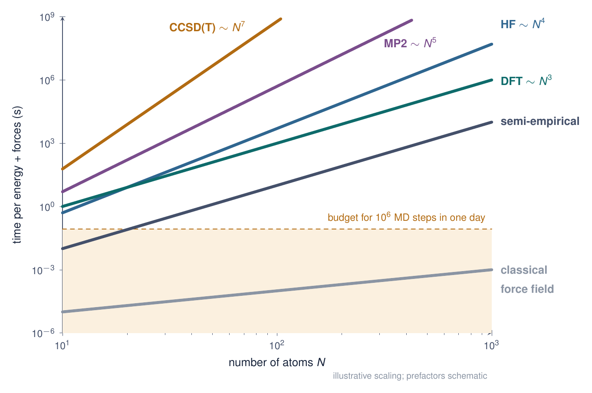
:::

::::

::: {.slide-ref}
M. J. S. Dewar, W. Thiel, *J. Am. Chem. Soc.* **99**, 4899 (1977); W. Thiel, *WIREs Comput. Mol. Sci.* **4**, 145 (2014).
:::

::: {.bridge .fragment}
Machine learning makes a similar trade, by fitting to data. So what kind of method is it?
:::

## Enter machine-learning potentials {data-section="Background"}

:::: {.columns .middle}

::: {.column width="48%"}
- Learn from reference calculations **once**
- Then predict energies and forces in milliseconds, close to the reference accuracy
- Nanosecond MD at near-reference accuracy becomes routine

::: {.ask}
Is machine learning a numerical, a semi-empirical, or an empirical method?
:::
:::

::: {.column width="52%"}
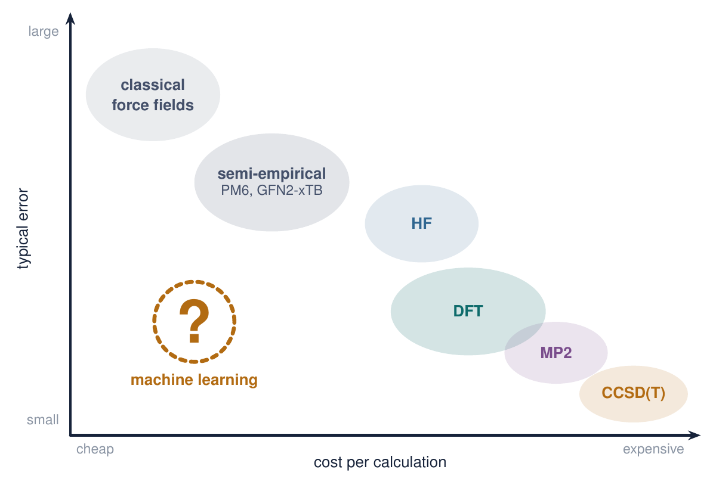
:::

::::

::: {.slide-ref}
J. Behler, *Chem. Rev.* **121**, 10037 (2021).
:::

::: {.notes}
Don't answer the question. Pause and let both halves of the room think.
:::

::: {.bridge .fragment}
Whatever it is, it learns from data. If labels are this expensive, why not pay once, at scale, for all of chemistry?
:::

## Foundation models for atoms {data-section="Background"}

:::: {.columns}

::: {.column width="48%"}
- More DFT calculations, bigger datasets: MPtrj (materials), OMol25 (molecules, 100M+ calculations)
- Pre-train once on millions of structures, then fine-tune or use zero-shot
- Examples: MACE-MP-0, UMA, PET-MAD

::: {.warn}
The assumption: they learn chemistry itself. Or do they stay grounded in what they have seen?
:::
:::

::: {.column width="52%"}
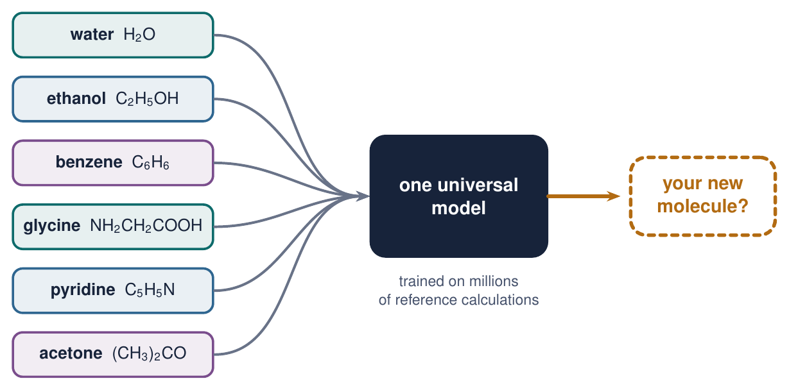
:::

::::

::: {.slide-ref}
I. Batatia *et al.*, arXiv:2401.00096 (2023); D. S. Levine *et al.*, arXiv (2025); A. Mazitov *et al.*, arXiv (2025).
:::

::: {.bridge .fragment}
Even with millions of structures, what happens where the data runs out?
:::

<!-- ===================== MOTIVATION ===================== -->

## What the data covers {data-section="Motivation"}

:::: {.columns}

::: {.column width="48%"}
- A model is only checked where its training data are
- Room-temperature MD samples the energy well densely, and the steep repulsive wall almost never
- On the wall the model has to guess, and it guesses wrong

::: {.key}
High-energy geometries the data does not cover: one kind of out-of-distribution.
:::
:::

::: {.column width="52%"}
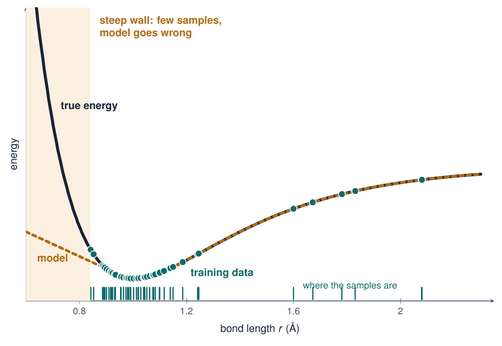
:::

::::

::: {.slide-ref}
J. Behler, *Chem. Rev.* **121**, 10037 (2021); X. Fu *et al.*, *Trans. Mach. Learn. Res.* (2023).
:::

::: {.bridge .fragment}
Now think of a reaction. Which point on the path does MD visit least?
:::

## Reactions: the rarest point matters most {data-section="Motivation"}

:::: {.columns}

::: {.column width="48%"}
- MD spends almost all its time in the reactant and product wells
- The **transition state** is visited rarely, so it is barely in the data
- At 298 K, every 1.4 kcal/mol of barrier error is a factor of 10 in the rate

::: {.key}
Rare events the data barely covers: a second kind of out-of-distribution.
:::
:::

::: {.column width="52%"}
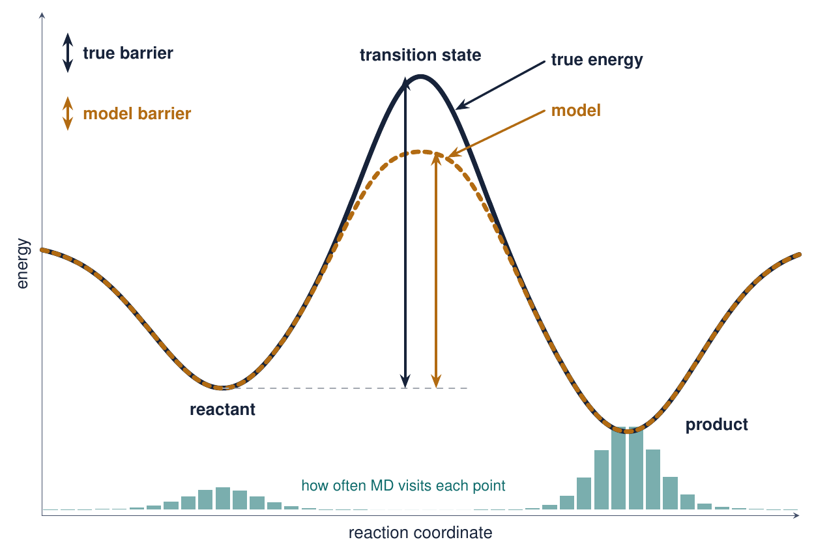
:::

::::

::: {.slide-ref}
H. Eyring, *J. Chem. Phys.* **3**, 107 (1935).
:::

::: {.notes}
From k ∝ exp(−ΔG‡/RT): RT ln 10 ≈ 1.36 kcal/mol at 298 K. Schematic profile.
:::

::: {.bridge .fragment}
Steep walls, rare events... what else counts as out-of-distribution?
:::

## Many ways to be out-of-distribution {data-section="Motivation"}

:::: {.columns}

::: {.column width="50%"}
**Out-of-distribution**: anything the training data does not represent, where the model has to go beyond its data rather than fill in between it.

- High-energy geometries; rare events
- Higher temperature than in training
- Elements, charges or spin states never seen
- Solvent or surfaces, when trained in vacuum
- **A new combination of known groups**
:::

::: {.column width="50%"}
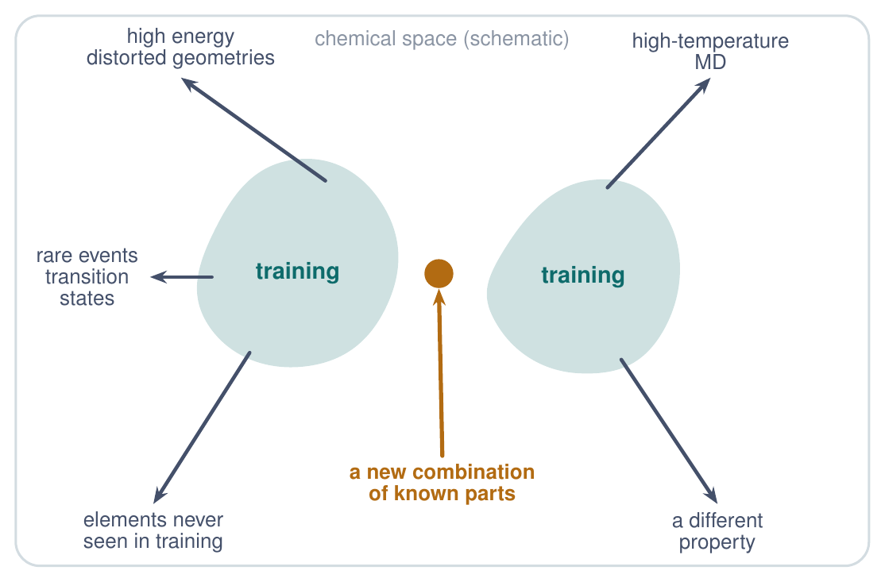
:::

::::

::: {.slide-ref}
S. Chmiela *et al.*, *Sci. Adv.* **3**, e1603015 (2017); X. Fu *et al.*, *Trans. Mach. Learn. Res.* (2023).
:::

::: {.notes}
All but the last change the conditions. The last one changes only the composition: every part is covered, the whole is not.
:::

::: {.bridge .fragment}
Which of these do we actually test when we evaluate ML potentials today?
:::

## How ML potentials are evaluated today {data-section="Motivation"}

:::: {.columns}

::: {.column width="50%"}
### Random splits
Test frames come from the same MD trajectories as training frames, so they are near-copies of what the model saw

### Shifts in conditions
Higher temperature, distorted geometries, rare events, unseen elements
:::

::: {.column width="50%"}
### Scaffold splits
Standard for predicting molecular **properties** (MoleculeNet), but not used for potentials

### What is missing
A controlled shift in **composition**: every part seen, only the whole new
:::

::::

::: {.key}
The test chemists would care about most, a new molecule built from known groups, is the one we rarely run.
:::

::: {.slide-ref}
S. Chmiela *et al.*, *Sci. Adv.* **3**, e1603015 (2017); X. Fu *et al.*, *TMLR* (2023); Z. Wu *et al.*, *Chem. Sci.* **9**, 513 (2018).
:::

::: {.bridge .fragment}
Shouldn't these models handle new combinations anyway? After all, they are built from local parts.
:::

## Locality: where chemistry and ML agree {data-section="Motivation"}

:::: {.columns}

::: {.column width="40%"}
- **Chemistry**: a property is roughly a sum of group contributions
- **ML potential**: the energy is a sum of contributions from each atom's neighbourhood
- Both say the whole is built from local parts

::: {.warn}
So compositional generalisation should come for free. Does it?
:::
:::

::: {.column width="60%"}
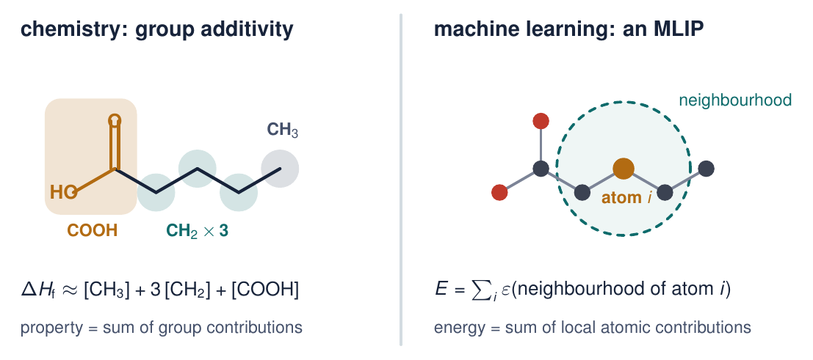
:::

::::

::: {.slide-ref}
S. W. Benson, J. H. Buss, *J. Chem. Phys.* **29**, 546 (1958); J. Behler, M. Parrinello, *Phys. Rev. Lett.* **98**, 146401 (2007).
:::

::: {.notes}
This is the bridge between the two halves of the room: Benson's additivity and the Behler–Parrinello energy decomposition have the same shape. Group-additivity values are schematic here.
:::

::: {.bridge .fragment}
How would we test that cleanly?
:::

## Our choice: scaffold out-of-distribution {data-section="Motivation"}

:::: {.columns}

::: {.column width="36%"}
- **Fusion**: –OH and C=O seen apart; tested together on one carbon, as –COOH
- **Duplication**: one –COOH seen; tested with two

::: {.key}
Every group is in training; only the molecule is new.
:::
:::

::: {.column width="64%"}
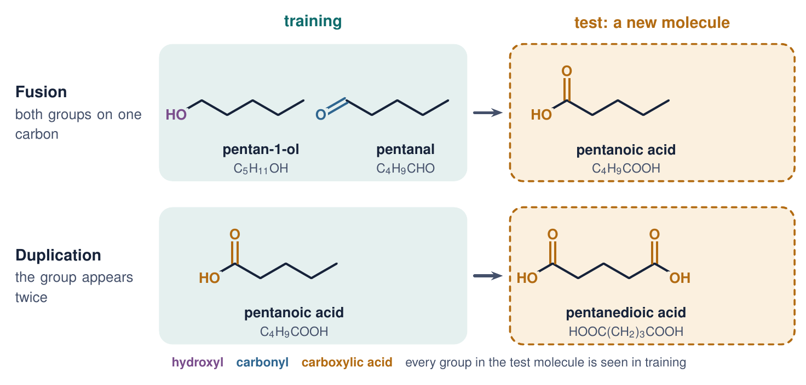
:::

::::

::: {.slide-ref}
G. W. Bemis, M. A. Murcko, *J. Med. Chem.* **39**, 2887 (1996); A. M. Nourollah *et al.*, *NeurIPS* (2026); arXiv:2605.08988.
:::

::: {.notes}
Two examples now; the full set of five comes in the next section.
:::

::: {.bridge .fragment}
To run this test properly, we need a dataset built for it. That is GMD.
:::

<!-- ===================== GMD ===================== -->

## GMD: Generalisation for Molecular Dynamics {data-section="GMD"}

:::: {.columns}

::: {.column width="46%"}
- 140 molecules in 12 families, built from H, C, N and O
- 300 K MD for each molecule, DFT energies and forces for every snapshot: about 280,000 configurations
- Splits are **by molecule**, never by snapshot

::: {.key}
Models are usually tested on new shapes of known molecules. GMD tests them on new molecules.
:::
:::

::: {.column width="54%"}
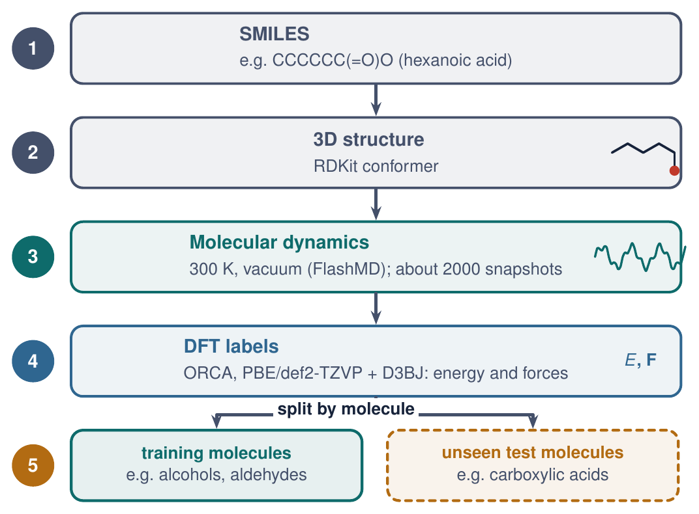
:::

::::

::: {.slide-ref}
A. M. Nourollah, I. Khalid, S. Leoni, S. Schockaert, *NeurIPS* (2026), Evaluations & Datasets Track; arXiv:2605.08988.
:::

::: {.notes}
Open data and code: huggingface.co/datasets/AmirMasoud/GMD. Splitting by molecule is what makes this a test of new molecules rather than new frames.
:::

::: {.bridge .fragment}
"New molecule" can mean many things. Which kinds of novelty do we test?
:::

## Which kinds of compositionality? {data-section="GMD"}

:::: {.columns}

::: {.column width="50%"}
### Five aspects, from linguistics and ML
Systematicity, productivity, substitutivity, localism, overgeneralisation

### GMD tests two of them
The two that transfer cleanly to atoms
:::

::: {.column width="50%"}
### Productivity
Handle **longer** structures than in training: one task, chain extension

### Systematicity
**Recombine** known parts in new ways: four tasks, fusion, duplication, combination, fission
:::

::::

::: {.key}
Each GMD task is one compositional operation, chosen from a framework the ML community already uses.
:::

::: {.slide-ref}
A. M. Nourollah, I. Khalid, S. Leoni, S. Schockaert, *NeurIPS* (2026), Evaluations & Datasets Track; arXiv:2605.08988.
:::

::: {.notes}
For chemists: productivity is "bigger molecules from the same pieces"; systematicity is "new arrangements of the same pieces". Substitutivity, localism and overgeneralisation do not transfer directly to atoms and are left to future work.
:::

::: {.bridge .fragment}
So what do these five operations look like?
:::

## Five ways to build a new molecule from known parts {data-section="GMD"}

:::: {.columns}

::: {.column width="58%"}
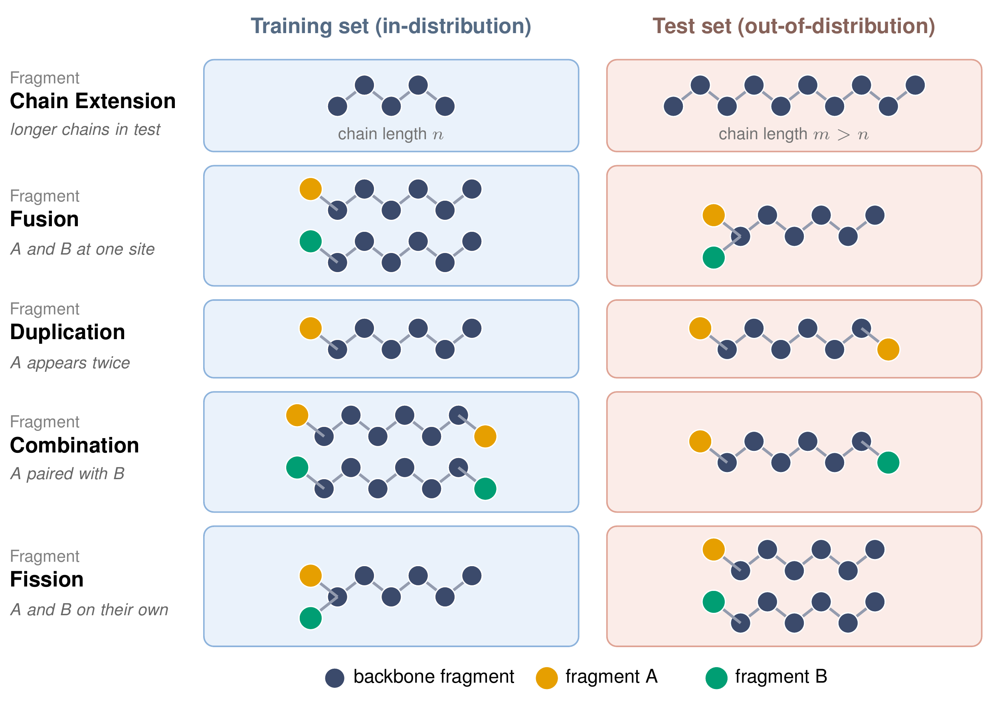{style="height:420px; max-height:420px"}
:::

::: {.column width="42%"}
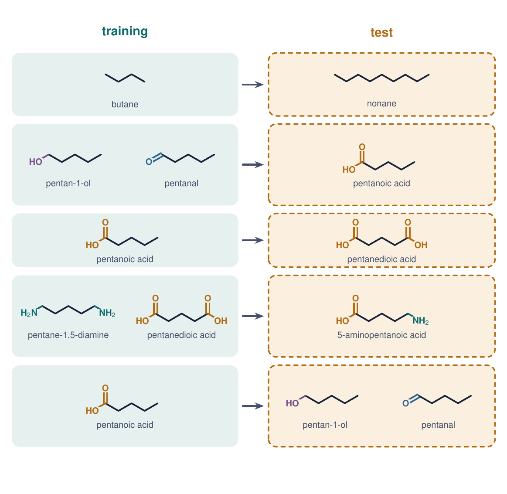{style="height:420px; max-height:420px"}
:::

::::

::: {.slide-ref}
A. M. Nourollah, I. Khalid, S. Leoni, S. Schockaert, *NeurIPS* (2026), Evaluations & Datasets Track; arXiv:2605.08988.
:::

::: {.notes}
Abstract task on the left, real molecules on the right, row by row. Chain extension: C2–C6 alkanes in training, C7–C13 at test, motivated by drug discovery, where models trained on fragments must handle larger lead compounds. Fusion: C4–C10 with extra complex carbonyls and alcohols for coverage. Duplication and fission: C5–C10. Combination: C2–C9. Why small molecules: one operation per task, every part of a test molecule is in training, chemists can check the answers, and failing the smallest step is a strong result.
:::

::: {.bridge .fragment}
But if a model fails, is it because it never saw enough, or because it cannot compose?
:::

## Two reasons a model could fail {data-section="GMD"}

:::: {.columns}

::: {.column width="50%"}
### Missing coverage
The model never saw long chains, or never saw a group in a given setting

*Fix: add the missing coverage to training*
:::

::: {.column width="50%"}
### Missing composition
The model saw every piece, but never learned how pieces combine

*Fix: show it a worked example of combining pieces*
:::

::::

::: {.key}
The augmented variants close the first gap and leave the second, so we can tell the two apart.
:::

::: {.slide-ref}
A. M. Nourollah, I. Khalid, S. Leoni, S. Schockaert, *NeurIPS* (2026), Evaluations & Datasets Track; arXiv:2605.08988.
:::

::: {.bridge .fragment}
What do the augmented variants look like?
:::

## The augmented variants {data-section="GMD"}

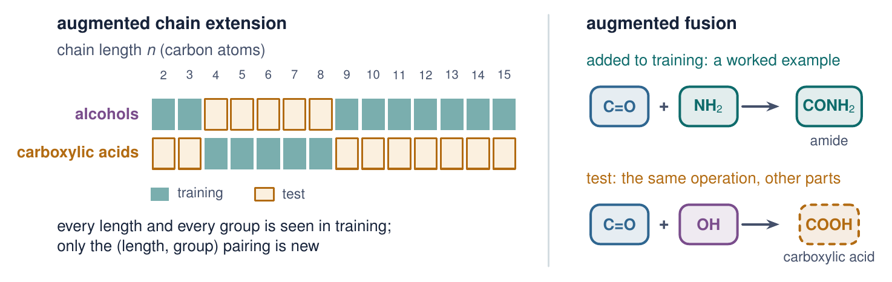{height="340px" fig-align="center"}

::: {.small style="text-align:center"}
Chain extension gets the missing coverage; fusion gets a worked example of composition.
:::

::: {.slide-ref}
A. M. Nourollah, I. Khalid, S. Leoni, S. Schockaert, *NeurIPS* (2026), Evaluations & Datasets Track; arXiv:2605.08988.
:::

::: {.bridge .fragment}
Which models do we put through all of this?
:::

## Models and protocol {data-section="GMD"}

:::: {.columns}

::: {.column width="50%"}
### Trained from scratch
SchNet, DimeNet++, GemNet, PaiNN, NequIP, MACE, eSCN, EquiFormerV2: from the oldest to the newest designs, 2017 to 2024

### Foundation models
MACE-MP-0 Small, Medium and Large and UMA-Small, fine-tuned per task; MACE-MP-0 Medium zero-shot
:::

::: {.column width="50%"}
### Error
Mean absolute error of energies and forces against DFT

### ID and OOD
On known molecules (in-distribution) and new ones (out-of-distribution); headline: the OOD/ID ratio
:::

::::

::: {.slide-ref}
A. M. Nourollah, I. Khalid, S. Leoni, S. Schockaert, *NeurIPS* (2026), Evaluations & Datasets Track; arXiv:2605.08988.
:::

::: {.notes}
Foundation models fine-tuned for 2000 epochs per task: an upper bound on what fine-tuning can do. [Check seeds and error bars before the talk.]
:::

::: {.bridge .fragment}
So what happens on new molecules?
:::

<!-- ===================== RESULTS ===================== -->

## Known molecules versus new molecules {data-section="Results"}

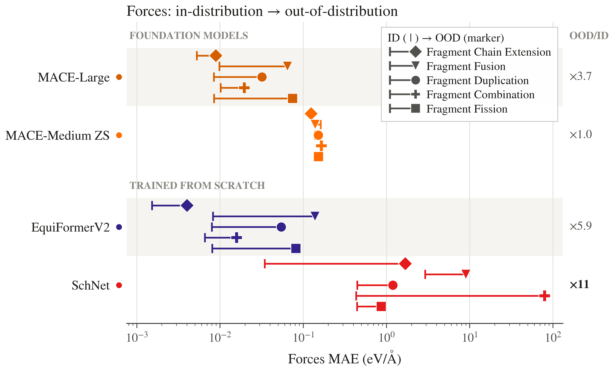{height="435px" fig-align="center"}

::: {.slide-ref}
A. M. Nourollah, I. Khalid, S. Leoni, S. Schockaert, *NeurIPS* (2026), Evaluations & Datasets Track; arXiv:2605.08988.
:::

::: {.notes}
Each bar runs from a model's error on known molecules (|) to its error on new ones, one marker per task; right column is the average OOD/ID ratio. MACE-Medium zero-shot shows ×1.0 only because it is already about ten times worse on known molecules. Energies are worse still: over 1000× on new molecules. In-distribution accuracy does not reliably predict out-of-distribution accuracy.
:::

::: {.bridge .fragment}
Where inside the molecule does the error appear?
:::

## Where the failure happens: inside the molecule {data-section="Results"}

:::: {.columns .middle}

::: {.column width="34%"}
- **Hexanoic acid**: new in the fusion task
- Inner disc: error in force **strength**; ring: error in **direction**
- Backbone fine; error on **–COOH**, mostly strength

::: {.warn}
Known: –OH and C=O. Not composed: –COOH.
:::
:::

::: {.column width="66%"}
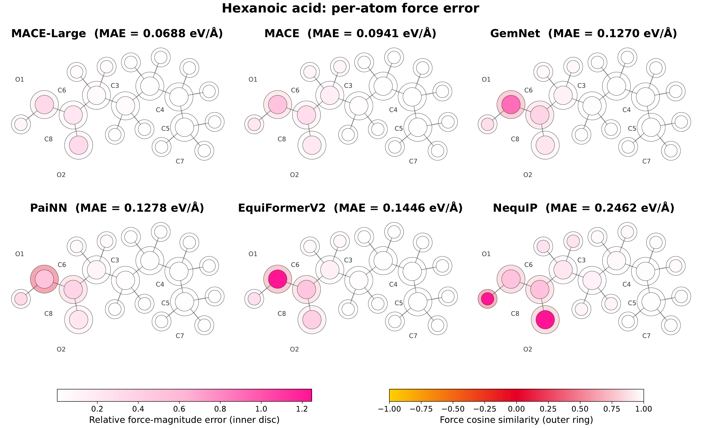
:::

::::

::: {.slide-ref}
A. M. Nourollah, I. Khalid, S. Leoni, S. Schockaert, *NeurIPS* (2026), Evaluations & Datasets Track; arXiv:2605.08988.
:::

::: {.notes}
Across tasks, direction errors localise on the heteroatoms of each task's new environment: oxygen for fusion, duplication and fission; the O–N pairing for combination. The same atoms are fine where their environment matches training.
:::

::: {.bridge .fragment}
Combining parts fails badly. How does the simplest task, a longer chain, compare?
:::

## Chain extension: a smaller drop {data-section="Results"}

:::: {.columns}

::: {.column width="40%"}
- Train on ethane to hexane; test on heptane to tridecane
- Errors **still rise** with length, but far less than in the other four tasks
- SchNet and DimeNet++ break down past the training lengths

::: {.key}
Repeating a known part costs some accuracy. Combining parts in a new way costs far more.
:::
:::

::: {.column width="60%"}
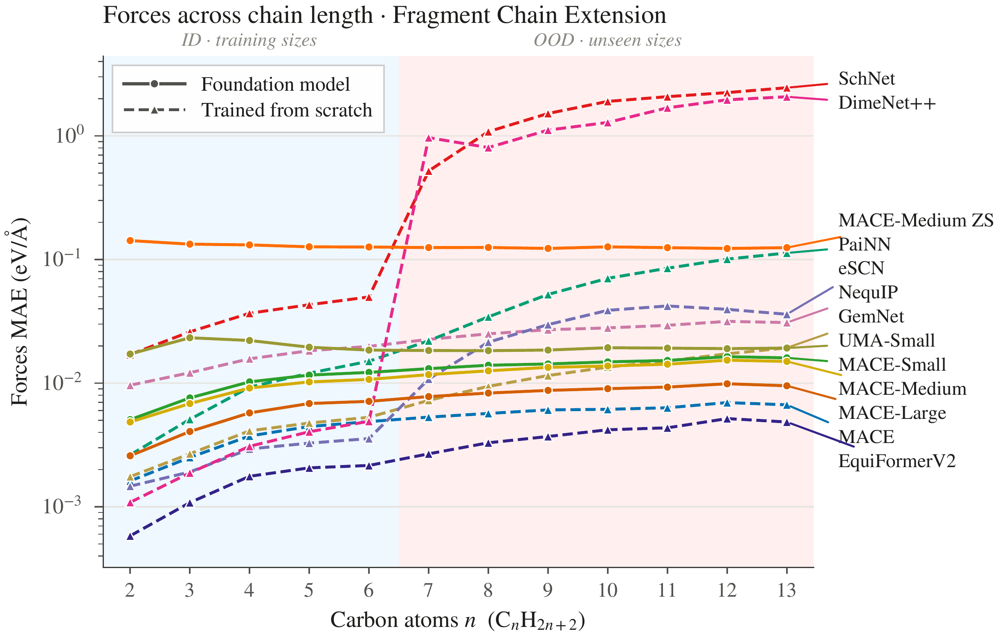
:::

::::

::: {.slide-ref}
A. M. Nourollah, I. Khalid, S. Leoni, S. Schockaert, *NeurIPS* (2026), Evaluations & Datasets Track; arXiv:2605.08988.
:::

::: {.bridge .fragment}
So is the problem coverage, or composition? The augmented variants answer that.
:::

## Coverage helps length, not composition {data-section="Results"}

:::: {.columns}

::: {.column width="50%"}
### Augmented chain extension
Much easier for every model except SchNet: OOD/ID close to ×1, and DimeNet++ recovers

*Coverage was the missing piece*
:::

::: {.column width="50%"}
### Augmented fusion
The amide example does not help: errors on carboxylic acids stay as large as before

*Composition is the missing piece*
:::

::::

::: {.warn}
Consistent with models treating each group as a standalone token, not learning how groups combine.
:::

::: {.slide-ref}
A. M. Nourollah, I. Khalid, S. Leoni, S. Schockaert, *NeurIPS* (2026), Evaluations & Datasets Track; arXiv:2605.08988.
:::

::: {.notes}
Paper Figure 19 has the full results if you want to show them here.
:::

::: {.bridge .fragment}
And if we run fusion backwards, can a model split a group it only saw whole?
:::

## Fission: the group is learned as one unit {data-section="Results"}

:::: {.columns .middle}

::: {.column width="40%"}
- Trained on carboxylic acids: –OH and C=O only ever appear **together**
- Tested on alcohols and aldehydes: each part **alone**
- The models cannot recover the parts

::: {.key}
Consistent with –COOH being learned as one unit, not built up from its parts.
:::
:::

::: {.column width="60%"}
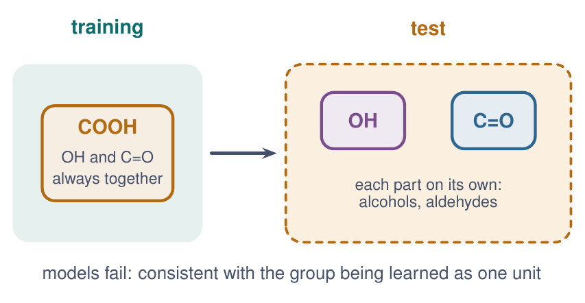
:::

::::

::: {.slide-ref}
A. M. Nourollah, I. Khalid, S. Leoni, S. Schockaert, *NeurIPS* (2026), Evaluations & Datasets Track; arXiv:2605.08988.
:::

::: {.notes}
Related to localism in the compositionality framework, but not a direct test of it: the –OH and C=O environments in the test molecules differ physically from those inside –COOH.
:::

::: {.bridge .fragment}
Could bigger models, pre-training or a different level of theory close the gap?
:::

## Not a data, scale or label problem {data-section="Results"}

:::: {.columns}

::: {.column width="50%"}
### Pre-training
Foundation models pre-trained on millions of structures do not consistently beat MACE trained from scratch

### Scale
Larger MACE-MP-0 helps on some tasks; the gap remains
:::

::: {.column width="50%"}
### Labels
GFN2-xTB labels instead of DFT give the same pattern

### Coverage
Helps chain extension, not fusion (previous slides)
:::

::::

::: {.warn}
Fine-tuning fixes the molecules the model was shown, not the ones it was not.
:::

::: {.slide-ref}
A. M. Nourollah, I. Khalid, S. Leoni, S. Schockaert, *NeurIPS* (2026), Evaluations & Datasets Track; arXiv:2605.08988.
:::

::: {.bridge .fragment}
So what does all this mean, for chemists and for machine learning?
:::

## What it means {data-section="Results"}

:::: {.columns}

::: {.column width="50%"}
### For chemists
- Errors sit on the new functional group: wrong vibrations, conformers, barriers
- They appear exactly where a molecule is new, which is where you would use a model
- A good score on known molecules says little about yours
:::

::: {.column width="50%"}
### For machine learning
- Locality in the architecture does not give compositional generalisation
- Scale, pre-training and fine-tuning do not either
- In-distribution accuracy does not reliably predict out-of-distribution accuracy
:::

::::

::: {.warn}
Before trusting a model on a new molecule, ask: has it seen this combination, or only these parts?
:::

::: {.slide-ref}
A. M. Nourollah, I. Khalid, S. Leoni, S. Schockaert, *NeurIPS* (2026), Evaluations & Datasets Track; arXiv:2605.08988.
:::

::: {.bridge .fragment}
How far do these conclusions reach, and where should we look next?
:::

<!-- ===================== TAKEAWAYS ===================== -->

## Scope and next steps for the benchmark {data-section="Takeaways"}

:::: {.columns}

::: {.column width="50%"}
### What GMD covers
Small H/C/N/O molecules in vacuum, one DFT level (PBE/def2-TZVP+D3BJ)

### Why that is enough
Every part of each test molecule is in training: failure under this minimal shift is a strong result
:::

::: {.column width="50%"}
### What it does not cover
Aromatic, charged, inorganic or transition-metal chemistry; condensed phases

### Natural extensions
Richer fragment vocabularies: peptides for proteins, monomers for polymers
:::

::::

::: {.slide-ref}
A. M. Nourollah, I. Khalid, S. Leoni, S. Schockaert, *NeurIPS* (2026), Evaluations & Datasets Track; arXiv:2605.08988.
:::

::: {.bridge .fragment}
So what do we take home, and can we teach a model to see molecules as we do?
:::

## Takeaways and future work {data-section="Takeaways"}

:::: {.columns}

::: {.column width="50%"}
### What we found
- **More of the same** (longer chains) costs some accuracy
- **Known parts in new combinations** cost far more
- Coverage, scale and pre-training do not fix composition
- Models learn groups as units, not from their parts
:::

::: {.column width="50%"}
### What I am working on
- A model whose learning is guided by chemical structure
- Forcing it to see a molecule as a chemist does: functional groups and how they connect

::: {.key}
Goal: a model that understands a new molecule from its parts.
:::
:::

::::

::: {.slide-ref}
A. M. Nourollah, I. Khalid, S. Leoni, S. Schockaert, *NeurIPS* (2026), Evaluations & Datasets Track; arXiv:2605.08988.
:::

## Thank you {.closing data-section="Takeaways"}

:::: {.columns .middle}

::: {.column width="50%"}
**Amir Masoud Nourollah**

Paper: arXiv:2605.08988 (NeurIPS 2026)

Data: huggingface.co/datasets/AmirMasoud/GMD

Code: github.com/Nourollah/GMD-26

::: {.key}
Questions?
:::
:::

::: {.column width="50%"}

:::

::::

<!-- ===================== BACKUP ===================== -->

## Backup: are the test environments really local repeats? {data-section="Takeaways"}

:::: {.columns}

::: {.column width="50%"}
- Expected question from ML people: with a cut-off of [r~c~] Å, does every OOD local environment appear in training?
- Partial answer from the paper: the same atoms are predicted well where their environment matches training, and poorly where it does not
- [Add any direct coverage measure you have]
:::

::: {.column width="50%"}
::: {.img-slot}
Image: local-environment coverage

[If available: nearest-training-neighbour distance of each OOD atomic environment, per task.]

`env_coverage.png`
:::
:::

::::

::: {.slide-ref}
A. M. Nourollah, I. Khalid, S. Leoni, S. Schockaert, *NeurIPS* (2026), Evaluations & Datasets Track; arXiv:2605.08988.
:::

<!-- ===================== APPENDIX ===================== -->

## Fitting well is not generalising well {data-section="Appendix"}

:::: {.columns}

::: {.column width="44%"}
- Two kinds of points: the model learns a **border** between them
- A straight line misses a few training points, but gets new points right
- A wiggly border gets **every** training point right, and new points wrong

::: {.key}
The goal is accuracy on data the model has never seen: **generalisation**.
:::
:::

::: {.column width="56%"}
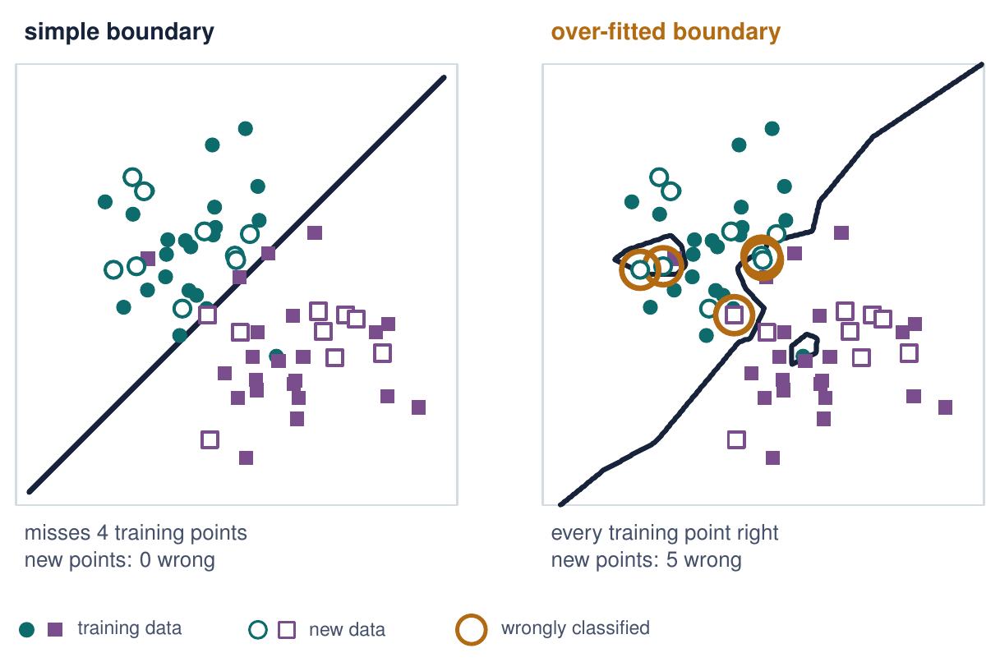
:::

::::

::: {.slide-ref}
C. M. Bishop, *Pattern Recognition and Machine Learning*, Springer (2006), §1.1, §4.1.
:::

::: {.bridge .fragment}
What about points that land outside everything the model has seen, or outside what our data covers?
:::
