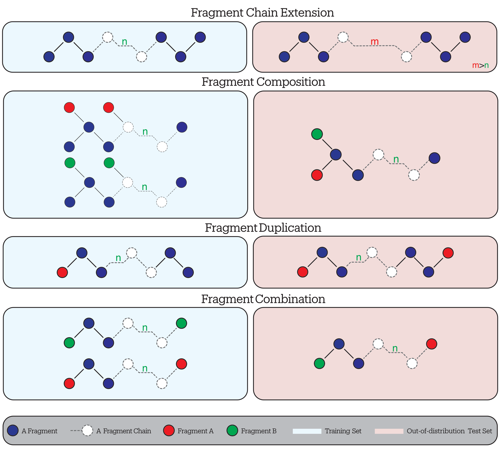

## Overview {data-section="Overview"}

::: {.agenda}
1. Text and emphasis
2. Columns and cards
3. Figures and tables
4. Headline numbers and takeaways
:::

## Text and Emphasis {.divider data-section="Text"}

## Write titles as claims, not topics

[A lead sentence states the point of the slide in plain words.]{.lead}

- Body text is large enough to read from the back of the room
- Use **bold** for key terms, [amber]{.amber} for your result, and [teal]{.teal} for the baseline
- Nested points stay readable
  - but keep them short

::: {.key}
Key point: one sentence the audience should remember from this slide.
:::

::: {.warn}
Warning: use amber for the surprising or failing case.
:::

## Columns and Cards {.divider data-section="Layout"}

## Two columns

:::: {.columns}
::: {.column width="50%"}
::: {.card .teal-card}
**Seen in training**

- Familiar chain lengths
- Familiar functional groups
:::
:::
::: {.column width="50%"}
::: {.card .amber-card}
**New combinations**

- Same parts, new arrangement
- Errors grow by orders of magnitude
:::
:::
::::

## Three columns

:::: {.columns}
::: {.column width="33%"}
::: {.card}
**Fusion**

Two groups merge into one composite group.
:::
:::
::: {.column width="33%"}
::: {.card}
**Duplication**

A familiar group appears twice.
:::
:::
::: {.column width="33%"}
::: {.card}
**Combination**

Two known groups share one backbone.
:::
:::
::::

## Figures and Tables {.divider data-section="Evidence"}

## A figure with a short explanation

:::: {.columns .middle}
::: {.column width="60%"}

:::
::: {.column width="40%"}
Put the evidence on the left, and two or three lines on the right telling the audience what to look at.

[Point at one thing only.]{.muted}

::: {.slide-ref}
References go in a `.slide-ref` block and sit just above the footer.
:::
:::
::::

## A clean results table

| Model        | Seen (meV/Å) | Unseen (meV/Å) | Ratio      |
|:-------------|-------------:|---------------:|-----------:|
| SchNet       | 12.4         | 418.0          | 34×        |
| MACE         | 3.1          | 96.2           | 31×        |
| EquiFormerV2 | **2.7**      | **88.5**       | **33×**    |
| UMA (FT)     | 3.4          | 140.9          | 41×        |

[Illustrative numbers only.]{.muted .small}

## Numbers and Takeaways {.divider data-section="Results"}

## {data-section="Results"}

::: {.big-number}
[1000×]{.number}
[larger error on molecules built from familiar parts]{.label}
:::

## Maths and code

The energy is a sum of atomic contributions:

$$
E = \sum_{i=1}^{N} \varepsilon\left(\mathbf{r}_i, \{\mathbf{r}_j\}_{j \in \mathcal{N}(i)}\right)
$$

``` python
model = MACE.from_pretrained("mace-mp-0")
forces = model(atoms).forces
```

## Thank you {.closing data-section="Close"}

Questions are welcome.

[nourollah.me](https://nourollah.me) · [arXiv:2605.08988](https://arxiv.org/abs/2605.08988)
